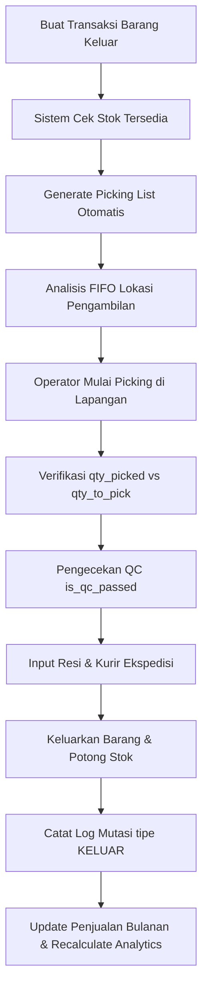

# PRODUCT REQUIREMENTS DOCUMENT (PRD) - WMS LAF

## 0. Inventory Awal & Daftar Tabel Database

Sistem ini didukung oleh database relasional SQL dengan struktur tabel yang dirancang untuk mendukung pelacakan stok multi-lokasi, audit transaksi, dan analisis replenishment.

### 0.1. Kamus Data & Skema Database

#### 1. Tabel Master & Konfigurasi

##### **`users`**
Menyimpan akun pengguna dan status keaktifan mereka.
*   `id` (bigint unsigned, Primary Key)
*   `name` (varchar(255)) - Nama lengkap user.
*   `email` (varchar(255), Unique) - Alamat email unik.
*   `email_verified_at` (timestamp, Nullable) - Waktu verifikasi email.
*   `password` (varchar(255)) - Hash password akun.
*   `is_active` (tinyint(1) / boolean, Default: 1) - Menandakan apakah user aktif atau dinonaktifkan.
*   `remember_token` (varchar(100), Nullable)
*   `created_at`, `updated_at` (timestamp)

##### **`mst_aturan_kode`**
Menyimpan konfigurasi pembuatan SKU/Kode Barang secara otomatis berdasarkan kategori produk.
*   `id` (bigint unsigned, Primary Key)
*   `kategori` (varchar(100), Nullable, Unique) - Kategori spesifik aturan kode. Jika bernilai `NULL`, berfungsi sebagai aturan default/fallback global.
*   `prefix` (varchar(50), Nullable) - Singkatan kode awal (contoh: `LAF`, `SANDAL`).
*   `include_category_prefix` (tinyint(1) / boolean, Default: 1) - Apakah menyertakan 3 karakter pertama kategori.
*   `include_product_initials` (tinyint(1) / boolean, Default: 1) - Apakah menyertakan inisial dari kata nama produk.
*   `include_variant_code` (tinyint(1) / boolean, Default: 1) - Apakah menyertakan singkatan variasi (warna & ukuran).
*   `increment_digits` (int, Default: 3) - Jumlah digit counter (contoh: `3` -> `001`, `4` -> `0001`).
*   `format_tipe` (varchar(50), Default: 'INCREMENT') - Jenis format penomoran, bernilai `INCREMENT` atau `PRD_STYLE` (untuk SKU bergaya Footwear).
*   `is_active` (tinyint(1) / boolean, Default: 1) - Status keaktifan aturan pengkodean.
*   `created_at`, `updated_at` (timestamp)

##### **`mst_lokasi`**
Menyimpan data fisik titik penyimpanan inventaris (Gudang atau Toko).
*   `id` (bigint unsigned, Primary Key)
*   `kode_lokasi` (varchar(100), Unique) - Kode unik lokasi (contoh: `GDG-A01`, `TKO-R01`).
*   `nama_lokasi` (varchar(200)) - Nama deskriptif lokasi.
*   `tipe_lokasi` (enum('GUDANG','TOKO'), Default: 'GUDANG') - Klasifikasi tipe lokasi fisik.
*   `is_active` (tinyint(1) / boolean, Default: 1) - Menandakan apakah lokasi masih digunakan.
*   `created_at`, `updated_at` (timestamp)

##### **`mst_pelanggan`**
Menyimpan data ritel atau pelanggan tujuan untuk pengiriman barang keluar.
*   `id` (bigint unsigned, Primary Key)
*   `nama_pelanggan` (varchar(200))
*   `kontak` (varchar(100)) - Nomor telepon atau kontak penanggung jawab.
*   `alamat` (text)
*   `created_at`, `updated_at` (timestamp)

##### **`mst_supplier`**
Menyimpan data vendor/pemasok barang untuk pemesanan barang masuk (Purchase Order).
*   `id` (bigint unsigned, Primary Key)
*   `nama_supplier` (varchar(200))
*   `kontak` (varchar(100)) - Nomor telepon atau kontak penanggung jawab.
*   `alamat` (text)
*   `created_at`, `updated_at` (timestamp)

##### **`mst_produk`**
Menyimpan master data barang/SKU tunggal beserta spesifikasi varian dan stok agregat.
*   `id` (bigint unsigned, Primary Key)
*   `kode_barang` (varchar(100), Unique) - SKU unik hasil generate otomatis.
*   `nama_produk` (varchar(200)) - Nama dasar produk (contoh: `Sandal Slide Active`).
*   `nama_barang` (varchar(200)) - Nama lengkap produk beserta varian (contoh: `Sandal Slide Active Hitam / 40`).
*   `kategori` (varchar(100)) - Kategori utama barang.
*   `kategori_2` (varchar(100), Nullable) - Kategori sekunder/sub-kategori.
*   `variasi_barang` (varchar(100)) - Teks variasi asli (contoh: `Hitam / 40`).
*   `warna` (varchar(100), Nullable) - Warna hasil ekstraksi variasi.
*   `size` (varchar(50), Nullable) - Ukuran hasil ekstraksi variasi.
*   `satuan` (varchar(20)) - Satuan barang (contoh: `Pcs`, `Pasang`).
*   `hpp` (decimal(15,2), Default: 0.00) - Nilai Harga Pokok Penjualan (HPP) berjalan (dihitung secara *Weighted Average*).
*   `harga_jual` (decimal(15,2), Default: 0.00) - Harga jual ke retail/pelanggan.
*   `stok_masuk` (int, Default: 0) - Akumulasi historis qty barang masuk.
*   `stok_keluar` (int, Default: 0) - Akumulasi historis qty barang keluar.
*   `total_stok` (int, Default: 0) - Jumlah stok riil agregat di seluruh lokasi aktif.
*   `lokasi` (varchar(100), Default: 'GDG-A01') - Kode lokasi default penyimpanan.
*   `is_active` (tinyint(1) / boolean, Default: 1) - Status keaktifan produk.
*   `created_at`, `updated_at` (timestamp)

---

#### 2. Tabel Transaksi Inbound (Penerimaan)

##### **`po_header`**
Dokumen pemesanan pembelian ke supplier.
*   `id` (bigint unsigned, Primary Key)
*   `tanggal` (date) - Tanggal dokumen PO diterbitkan.
*   `supplier_id` (bigint unsigned, Foreign Key -> `mst_supplier`.onDelete: cascade)
*   `artikel` (varchar(200)) - Deskripsi umum pesanan / nama artikel.
*   `jumlah` (int) - Total kuantitas barang yang dipesan dalam dokumen.
*   `created_at`, `updated_at` (timestamp)

##### **`po_detail`**
Detail produk dan jumlah yang dipesan per baris PO.
*   `id` (bigint unsigned, Primary Key)
*   `po_header_id` (bigint unsigned, Foreign Key -> `po_header`.onDelete: cascade)
*   `produk_id` (bigint unsigned, Foreign Key -> `mst_produk`.onDelete: cascade)
*   `jumlah` (int) - Kuantitas pesanan awal.
*   `barang_masuk` (int, Default: 0) - Kuantitas yang telah diterima secara fisik di gudang.
*   `sisa` (int) - Sisa kuantitas yang belum diterima (`jumlah` - `barang_masuk`).
*   `hpp` (decimal(15,2)) - Harga beli per unit yang disepakati.
*   `total_hpp` (decimal(15,2)) - Total harga beli sisa barang (`sisa` * `hpp`).
*   `created_at`, `updated_at` (timestamp)

##### **`trx_barang_masuk_header`**
Pencatatan penerimaan fisik barang masuk.
*   `id` (bigint unsigned, Primary Key)
*   `nomor_nota` (varchar(100), Unique) - Nomor seri transaksi (Format: `BM/YYYYMMDD/XXXX`).
*   `tanggal` (date) - Tanggal penerimaan barang.
*   `tipe_nota` (enum('Stock Awal', 'Pembelian', 'Retur Masuk', 'Penyesuaian')) - Alasan barang masuk.
*   `supplier_id` (bigint unsigned, Nullable, Foreign Key -> `mst_supplier`.onDelete: set null) - Nullable untuk transaksi non-pembelian.
*   `keterangan_tambahan` (text, Nullable)
*   `data_dimasukan_oleh` (varchar(100)) - Nama user pembuat.
*   `created_at`, `updated_at` (timestamp)

##### **`trx_barang_masuk_detail`**
Detail produk yang diterima per nota masuk.
*   `id` (bigint unsigned, Primary Key)
*   `barang_masuk_header_id` (bigint unsigned, Foreign Key -> `trx_barang_masuk_header`.onDelete: cascade)
*   `produk_id` (bigint unsigned, Foreign Key -> `mst_produk`.onDelete: cascade)
*   `qty_masuk` (int) - Kuantitas yang diterima.
*   `satuan` (varchar(20))
*   `lokasi_simpan` (varchar(100)) - Kode lokasi penempatan fisik barang (contoh: `GDG-A01`).
*   `hpp` (decimal(15,2)) - Nilai harga beli per unit saat penerimaan berjalan.
*   `po_detail_id` (bigint unsigned, Nullable, Foreign Key -> `po_detail`.onDelete: set null) - Referensi detail baris PO jika terikat.
*   `created_at`, `updated_at` (timestamp)

---

#### 3. Tabel Transaksi Outbound (Pengeluaran)

##### **`trx_barang_keluar_header`**
Pencatatan pengeluaran inventaris dari sistem.
*   `id` (bigint unsigned, Primary Key)
*   `nomor_nota` (varchar(100), Unique) - Nomor seri transaksi (Format: `BK/YYYYMMDD/XXXX`).
*   `tanggal` (date) - Tanggal pengeluaran barang.
*   `tipe_nota` (enum('Penjualan', 'Retur Keluar', 'Penyesuaian', 'Sample')) - Jenis transaksi keluar.
*   `pelanggan_id` (bigint unsigned, Foreign Key -> `mst_pelanggan`.onDelete: cascade)
*   `keterangan_tambahan` (text, Nullable)
*   `dikeluarkan_oleh` (varchar(100)) - Nama operator yang memproses.
*   `created_at`, `updated_at` (timestamp)

##### **`trx_barang_keluar_detail`**
Detail produk yang dikeluarkan per nota keluar beserta validasi pengiriman.
*   `id` (bigint unsigned, Primary Key)
*   `barang_keluar_header_id` (bigint unsigned, Foreign Key -> `trx_barang_keluar_header`.onDelete: cascade)
*   `produk_id` (bigint unsigned, Foreign Key -> `mst_produk`.onDelete: cascade)
*   `qty_keluar` (int) - Kuantitas yang dikeluarkan.
*   `satuan` (varchar(20))
*   `lokasi_pengambilan` (varchar(100)) - Kode lokasi tempat pengambilan fisik barang.
*   `hpp` (decimal(15,2)) - Snapshot HPP produk saat pengeluaran diproses (untuk kalkulasi nilai aset keluar).
*   `resi_ekspedisi` (varchar(200), Nullable) - Nomor resi pelacakan ekspedisi/kurir.
*   `kurir` (varchar(100), Nullable) - Nama jasa kurir yang digunakan.
*   `is_qc_passed` (tinyint(1) / boolean, Default: 0) - Flag status lolos pengecekan kualitas barang.
*   `created_at`, `updated_at` (timestamp)

---

#### 4. Tabel Manajemen Stok & Logistik Internal

##### **`trx_stok_lokasi`**
Menyimpan jumlah kuantitas riil produk di masing-masing lokasi penyimpanan secara spesifik.
*   `id` (bigint unsigned, Primary Key)
*   `produk_id` (bigint unsigned, Foreign Key -> `mst_produk`.onDelete: cascade)
*   `lokasi_id` (bigint unsigned, Foreign Key -> `mst_lokasi`.onDelete: cascade)
*   `qty` (int, Default: 0) - Jumlah stok fisik di lokasi ini.
*   `created_at`, `updated_at` (timestamp)
*   *Unique Constraint:* `['produk_id', 'lokasi_id']` (Mencegah duplikasi entri produk per lokasi).

##### **`trx_mutasi_lokasi`**
Buku jurnal log pergerakan stok ("Double-Entry" Inventory Log). Setiap perubahan stok wajib mencatat baris di tabel ini.
*   `id` (bigint unsigned, Primary Key)
*   `produk_id` (bigint unsigned, Foreign Key -> `mst_produk`.onDelete: cascade)
*   `lokasi_asal_id` (bigint unsigned, Nullable, Foreign Key -> `mst_lokasi`.onDelete: set null) - Lokasi pengirim.
*   `lokasi_tujuan_id` (bigint unsigned, Nullable, Foreign Key -> `mst_lokasi`.onDelete: set null) - Lokasi penerima.
*   `qty` (int) - Jumlah kuantitas barang yang bergerak.
*   `tipe_mutasi` (varchar(50)) - Jenis perubahan stok: `MASUK`, `KELUAR`, `TRANSFER`, `OPNAME_ADJUST`.
*   `referensi_tipe` (varchar(100), Nullable) - Class model yang memicu (contoh: `App\Models\BarangMasuk`, `App\Models\TransferHeader`).
*   `referensi_id` (bigint unsigned, Nullable) - Primary key dari model pemicu.
*   `keterangan` (text, Nullable) - Detail pelengkap transaksi.
*   `data_dimasukan_oleh` (varchar(100)) - Nama user penginput.
*   `created_at`, `updated_at` (timestamp)

##### **`trx_transfer_header`**
Pencatatan transaksi pemindahan barang antar-lokasi (gudang/toko).
*   `id` (bigint unsigned, Primary Key)
*   `nomor_transfer` (varchar(100), Unique) - Nomor bukti transfer (Format: `TRF/YYYYMMDD/XXXX`).
*   `tanggal` (date)
*   `lokasi_asal_id` (bigint unsigned, Foreign Key -> `mst_lokasi`.onDelete: cascade)
*   `lokasi_tujuan_id` (bigint unsigned, Foreign Key -> `mst_lokasi`.onDelete: cascade)
*   `status` (enum('DRAFT', 'PICKING', 'IN_TRANSIT', 'RECEIVED', 'CLOSED', 'CANCELLED'), Default: 'DRAFT')
*   `keterangan` (text, Nullable)
*   `created_by` (varchar(100)) - User pembuat transfer.
*   `received_by` (varchar(100), Nullable) - User penerima barang di tujuan.
*   `received_at` (timestamp, Nullable) - Waktu konfirmasi barang tiba.
*   `created_at`, `updated_at` (timestamp)

##### **`trx_transfer_detail`**
Detail item barang dan kuantitas pengiriman/penerimaan transfer.
*   `id` (bigint unsigned, Primary Key)
*   `transfer_header_id` (bigint unsigned, Foreign Key -> `trx_transfer_header`.onDelete: cascade)
*   `produk_id` (bigint unsigned, Foreign Key -> `mst_produk`.onDelete: cascade)
*   `qty_requested` (int, Default: 0) - Qty yang diajukan untuk dipindahkan.
*   `qty_sent` (int, Default: 0) - Qty aktual yang berhasil dikirim dari lokasi asal.
*   `qty_received` (int, Default: 0) - Qty aktual yang diterima di lokasi tujuan.
*   `created_at`, `updated_at` (timestamp)

##### **`trx_picking_list`**
Penugasan operator gudang untuk mengambil barang di rak penyimpanan.
*   `id` (bigint unsigned, Primary Key)
*   `nomor_picking` (varchar(100), Unique) - Kode penugasan (Format: `PCK/YYYYMMDD/XXXX`).
*   `referensi_tipe` (varchar(100)) - Jenis pemicu picking (bernilai `BarangKeluar` atau `TransferHeader`).
*   `referensi_id` (unsigned BigInteger) - ID model pemicu terkait.
*   `lokasi_id` (bigint unsigned, Foreign Key -> `mst_lokasi`.onDelete: cascade) - Lokasi asal picking.
*   `status` (enum('PENDING', 'PICKING', 'COMPLETED', 'CANCELLED'), Default: 'PENDING')
*   `picker_name` (varchar(100), Nullable) - Operator picker yang ditugaskan.
*   `started_at` (timestamp, Nullable) - Waktu proses picking mulai berjalan.
*   `completed_at` (timestamp, Nullable) - Waktu picking selesai diverifikasi.
*   `created_at`, `updated_at` (timestamp)

##### **`trx_picking_detail`**
Daftar produk dan alokasi rak fisik tempat pengambilan berdasarkan analisis FIFO.
*   `id` (bigint unsigned, Primary Key)
*   `picking_list_id` (bigint unsigned, Foreign Key -> `trx_picking_list`.onDelete: cascade)
*   `produk_id` (bigint unsigned, Foreign Key -> `mst_produk`.onDelete: cascade)
*   `lokasi_rak_id` (bigint unsigned, Nullable, Foreign Key -> `mst_lokasi`.onDelete: set null) - Rak/lokasi fisik spesifik rekomendasi FIFO.
*   `qty_to_pick` (int, Default: 0) - Target kuantitas yang harus diambil.
*   `qty_picked` (int, Default: 0) - Kuantitas aktual yang berhasil diambil operator.
*   `is_verified` (tinyint(1) / boolean, Default: 0) - Menandakan apakah pengambilan item telah tuntas (`qty_picked` >= `qty_to_pick`).
*   `created_at`, `updated_at` (timestamp)

##### **`trx_opname_header`**
Pencatatan sesi audit fisik (Stock Opname) berkala.
*   `id` (bigint unsigned, Primary Key)
*   `nomor_opname` (varchar(100), Unique) - Format kode opname.
*   `tanggal` (date)
*   `lokasi_id` (bigint unsigned, Foreign Key -> `mst_lokasi`.onDelete: cascade) - Gudang/toko yang di-opname.
*   `status` (enum('DRAFT', 'COMPLETED', 'ADJUSTED', 'CANCELLED'), Default: 'DRAFT')
*   `keterangan` (text, Nullable)
*   `operator_name` (varchar(100)) - Staf pelaksana opname.
*   `adjusted_by` (varchar(100), Nullable) - Manajer/Admin penyetuju penyesuaian stok.
*   `adjusted_at` (timestamp, Nullable) - Waktu eksekusi adjustment ke stok sistem.
*   `created_at`, `updated_at` (timestamp)

##### **`trx_opname_detail`**
Hasil perbandingan data stok sistem dengan data stok fisik di lapangan per produk.
*   `id` (bigint unsigned, Primary Key)
*   `opname_header_id` (bigint unsigned, Foreign Key -> `trx_opname_header`.onDelete: cascade)
*   `produk_id` (bigint unsigned, Foreign Key -> `mst_produk`.onDelete: cascade)
*   `qty_sistem` (int, Default: 0) - Kuantitas tercatat di sistem pada saat opname dibuka.
*   `qty_fisik` (int, Default: 0) - Kuantitas fisik riil yang dihitung operator.
*   `selisih` (int, Default: 0) - Perbedaan angka (`qty_fisik` - `qty_sistem`).
*   `catatan` (text, Nullable) - Penjelasan selisih.
*   `created_at`, `updated_at` (timestamp)

---

#### 5. Tabel Analitik & Keamanan

##### **`analytics_produk`**
Menyimpan performa histori penjualan tahunan dan data kalkulasi replenishment produk.
*   `id` (bigint unsigned, Primary Key)
*   `produk_id` (bigint unsigned, Foreign Key -> `mst_produk`.onDelete: cascade)
*   `kategori` (varchar(100)) - Kategori master produk.
*   `penjualan_jan` s/d `penjualan_des` (int, Default: 0) - Data penjualan bulanan aktual (hanya dihitung dari transaksi `BarangKeluar` bertipe `Penjualan`).
*   `rata_rata_harian` (decimal(10,2), Default: 0.00) - Rata-rata kuantitas penjualan per hari (Total penjualan 12 bulan / 365).
*   `abc_class` (char(1), Nullable) - Klasifikasi produk berdasarkan volume penjualan (`A` = Fast Moving, `B` = Medium, `C` = Slow Moving).
*   `leadtime_produksi` (int, Default: 14) - Estimasi waktu tunggu pemesanan ke supplier (dalam hari).
*   `minimal_stock` (int, Default: 0) - Batas stok aman sebelum harus memesan kembali (*Reorder Point*).
*   `safety_stock` (int, Default: 0) - Stok cadangan darurat.
*   `maximum_stock` (int, Default: 0) - Batas kapasitas penyimpanan ideal gudang.
*   `is_manual_stock` (tinyint(1) / boolean, Default: 0) - Flag untuk menonaktifkan penghitungan otomatis min/max/safety stok agar dapat diinput manual.
*   `created_at`, `updated_at` (timestamp)

##### **`trx_audit_logs`**
Jejak audit keamanan penuh untuk merekam setiap operasi pembuatan, modifikasi, dan penghapusan data transaksi krusial.
*   `id` (bigint unsigned, Primary Key)
*   `user_id` (bigint unsigned, Nullable, Foreign Key -> `users`.onDelete: set null) - ID user pelaksana.
*   `username` (varchar(100)) - Nama user pelaksana saat aksi terjadi.
*   `action` (varchar(20)) - Aksi database: `CREATE`, `UPDATE`, `DELETE`.
*   `auditable_type` (varchar(150)) - Nama class Model (contoh: `App\Models\BarangMasuk`).
*   `auditable_id` (bigint unsigned) - Primary Key record Model yang terpengaruh.
*   `old_values` (json, Nullable) - Snapshot data model lama (sebelum diubah/dihapus).
*   `new_values` (json, Nullable) - Snapshot data model baru (setelah dibuat/diubah).
*   `ip_address` (varchar(45), Nullable) - IP address pelaksana.
*   `user_agent` (text, Nullable) - User agent browser/perangkat pelaksana.
*   `created_at`, `updated_at` (timestamp)
*   *Index:* `['auditable_type', 'auditable_id']` (Mempercepat query pencarian riwayat modifikasi entitas).

---

## 1. Ringkasan Produk
**Nama Produk:** WMS Laf (Warehouse Management System)  
**Tujuan Bisnis Inti:** Menyediakan platform pergudangan tersentralisasi untuk melacak dan mengontrol pergerakan inventaris dari pemesanan supplier hingga penyerahan barang ke retail/toko/pelanggan. Sistem menjamin sinkronisasi real-time antara stok fisik per lokasi (`trx_stok_lokasi`), stok total sistem (`mst_produk`), mencatat log mutasi lengkap, menghitung HPP secara dinamis, dan memberikan rekomendasi replenishment otomatis berbasis data penjualan aktual.

---

## 2. Peta Modul & Domain Fungsional

Sistem dibagi menjadi **6 Modul Utama**:

| Modul | Deskripsi & Tujuan | Entitas Utama yang Terlibat |
| :--- | :--- | :--- |
| **1. Master Data** | Mengelola entitas dasar dan konfigurasi SKU otomatis. | `users`, `mst_produk`, `mst_supplier`, `mst_pelanggan`, `mst_lokasi`, `mst_aturan_kode` |
| **2. Inbound (Penerimaan)** | Alur Purchase Order (PO) hingga pencatatan fisik barang masuk dan perhitungan HPP. | `po_header`, `po_detail`, `trx_barang_masuk_header`, `trx_barang_masuk_detail` |
| **3. Inventory & Internal** | Pemindahan barang antar lokasi, stock opname, dan pelacakan mutasi stok lokasi. | `trx_stok_lokasi`, `trx_mutasi_lokasi`, `trx_transfer_header`, `trx_transfer_detail`, `trx_opname_header`, `trx_opname_detail` |
| **4. Outbound (Pengeluaran)** | Alur picking FIFO, verifikasi picking, Quality Control, dan packing/shipping. | `trx_picking_list`, `trx_picking_detail`, `trx_barang_keluar_header`, `trx_barang_keluar_detail` |
| **5. Reporting & Analytics** | Analisis klasifikasi ABC, kalkulasi min/max stok, dan dashboard replenishment toko. | `analytics_produk`, view reports |
| **6. System & Security** | Otorisasi peran pengguna (Spatie RBAC) dan log audit komprehensif. | `roles`, `permissions`, `trx_audit_logs` |

---

## 3. User Roles & Permission Matrix

Akses fitur dibatasi ketat melalui integrasi Spatie Laravel Permission:

| Role | Master Data | Inbound (PO & Masuk) | Outbound (Keluar) | Internal (Transfer/Opname) | Analytics & Report | System (Users) |
| :--- | :--- | :--- | :--- | :--- | :--- | :--- |
| **Super Admin** | Manage (CRUD) | Manage (CRUD) | Manage (CRUD) | Manage (CRUD) | View Only | Manage (CRUD) |
| **Admin** | Manage (CRUD) | Manage (CRUD) | Manage (CRUD) | Manage (CRUD) | View Only | - |
| **Sales** | View Only | Manage PO | Create (BK) | - | - | - |
| **Operator Gudang**| View Only | Create (BM) | Create (BK) | Manage (TRF/Opname) | - | - |
| **Finance** | View Only | View PO | - | - | View Only | - |

---

## 4. Alur Kerja Detil & Aturan Bisnis (Workflows)

### 4.1. Alur Inbound (Penerimaan Barang & Manajemen HPP)
Modul ini menangani pencatatan barang yang masuk ke area gudang fisik.

```mermaid
graph TD
    A[Buat Purchase Order] --> B[Barang Datang di Gudang]
    B --> C{Punya Referensi PO?}
    C -->|Ya| D[Input Penerimaan dengan Referensi po_detail_id]
    C -->|Tidak| E[Input Penerimaan Mandiri (Stock Awal/Retur)]
    D --> F[Kurangi sisa di po_detail]
    E --> G[Proses Penerimaan Fisik]
    F --> G
    G --> H[Update Stok Lokasi & Total Stok Produk]
    H --> I[Hitung HPP dengan Weighted Average]
    I --> J[Catat Log Mutasi tipe MASUK]
```

#### Aturan Bisnis & Mekanisme Teknis:
1.  **Pengurangan Sisa PO:** Penerimaan barang dengan referensi PO akan memotong kolom `po_detail.sisa` dan menambah kolom `po_detail.barang_masuk`.
2.  **Perhitungan HPP Weighted Average:** Setiap barang masuk (tipe `Pembelian` / `Stock Awal` / `Retur Masuk`) wajib menghitung ulang HPP produk bersangkutan pada `mst_produk.hpp` menggunakan formula:
    *   Jika $\text{Stok Sebelumnya} \le 0$:
        $$\text{HPP Baru} = \text{Harga Transaksi Baru}$$
    *   Jika $\text{Stok Sebelumnya} > 0$:
        $$\text{HPP Baru} = \frac{(\text{Stok Sebelumnya} \times \text{HPP Sebelumnya}) + (\text{Qty Baru} \times \text{Harga Baru})}{\text{Stok Sebelumnya} + \text{Qty Baru}}$$
3.  **Metode Reversal & Re-Apply (Ubah/Hapus Transaksi):**
    *   Apabila transaksi barang masuk diubah (`ubahBarangMasuk`) atau dihapus (`hapusBarangMasuk`), sistem melakukan **reversal** (pembalikan) nilai stok dan HPP ke kondisi sebelum transaksi tersebut terjadi untuk menjaga akurasi laporan keuangan.
    *   **Guard Safe:** Reversal tidak diperbolehkan jika menyebabkan `total_stok` produk atau `qty` pada `trx_stok_lokasi` bernilai negatif.
4.  **Audit Logs:** Perubahan atau penghapusan transaksi barang masuk akan direkam secara rinci pada tabel `trx_audit_logs` dengan menyimpan snapshot array `old_values` dan `new_values`.

---

### 4.2. Alur Outbound (Pengeluaran Barang & Picking FIFO)
Modul ini mengelola pencatatan pengiriman barang keluar dari gudang menuju pelanggan atau ritel.



#### Aturan Bisnis & Mekanisme Teknis:
1.  **Rekomendasi Lokasi FIFO:** Pembuatan `trx_picking_list` secara otomatis menyusun lokasi rak pengambilan (`trx_picking_detail.lokasi_rak_id`) menggunakan urutan FIFO:
    *   Sistem melacak penerimaan barang masuk tertua per lokasi dari `trx_barang_masuk_detail` berdasarkan tanggal nota terkecil (`MIN(tanggal)`).
    *   Kuantitas yang diminta didistribusikan ke lokasi-lokasi penyimpanan dengan prioritas stok tertua hingga kuota terpenuhi.
2.  **Verifikasi & Validasi:** Operator harus melakukan konfirmasi jumlah barang fisik yang diambil. Status picking list berubah dari `PENDING` -> `PICKING` -> `COMPLETED` saat semua item terverifikasi (`is_verified` = 1).
3.  **Quality Control & Shipping:** Kolom `is_qc_passed`, `resi_ekspedisi`, dan `kurir` pada detail pengeluaran memastikan barang telah diperiksa fisiknya sebelum diserahkan ke kurir pengiriman.
4.  **Sinkronisasi Analitik:** Setiap pengeluaran bertipe `Penjualan` akan langsung memicu pembaruan data penjualan produk bulanan pada `analytics_produk` dan menghitung ulang klasifikasi kelas ABC.

---

### 4.3. Alur Pemindahan Stok & Opname Internal
Mengontrol integritas data dan pergerakan stok antar-rak, gudang, maupun penyesuaian fisik.

#### A. Transfer Stok (Antar Lokasi)
Alur transfer stok memiliki siklus hidup state machine sebagai berikut:
1.  **DRAFT:** Dokumen dibuat oleh user asal. Belum ada pengurangan stok.
2.  **PICKING:** Dokumen didaftarkan ke picking list gudang asal. Operator menyiapkan barang.
3.  **IN_TRANSIT:** Pengiriman dikonfirmasi (`processShipment`). Stok di lokasi asal berkurang dan `total_stok` agregat diperbarui. Catat log mutasi `tipe_mutasi` = `TRANSFER`.
4.  **RECEIVED:** Barang diterima oleh lokasi tujuan (`processReceive`). Operator tujuan memverifikasi `qty_received` (maksimal sebesar `qty_sent`). Stok di lokasi tujuan bertambah dan `total_stok` global disinkronkan kembali.
5.  **CLOSED:** Sesi ditutup penuh secara permanen.
6.  **CANCELLED:** Pembatalan hanya bisa dilakukan jika status belum masuk fase *In Transit*.

#### B. Stock Opname (Rekonsiliasi Fisik)
*   Sesi opname dibuat untuk lokasi tertentu (`lokasi_id`). Selama sesi berstatus `DRAFT`, operator memasukkan jumlah fisik riil (`qty_fisik`).
*   Sistem menghitung `selisih` (`qty_fisik` - `qty_sistem`).
*   Saat disetujui (`status` = `ADJUSTED`), sistem akan melakukan *Auto-Adjustment*:
    1.  Memperbarui `qty` di tabel `trx_stok_lokasi` sesuai angka `qty_fisik`.
    2.  Menghitung ulang total stok global produk pada `mst_produk.total_stok`.
    3.  Mencatat log mutasi stok pada `trx_mutasi_lokasi` dengan tipe `OPNAME_ADJUST`.

---

### 4.4. SKU Auto-Generator
Sistem melarang penginputan SKU secara manual untuk mencegah tumpang tindih penamaan dan tidak seragamnya standar penamaan barang.

#### Algoritma Pembuatan Kode (SkuGeneratorService):
Sistem mendukung dua opsi format sesuai pengaturan tabel `mst_aturan_kode`:

##### **Opsi A: Format INCREMENT (Standar)**
Menggabungkan token terpisah tanda hubung (`-`):
1.  **Prefix:** Ditentukan di master aturan (contoh: `LAF`).
2.  **Category Prefix:** 3 karakter pertama kategori produk (contoh: `SEPATU` -> `SEP`).
3.  **Product Initials:** Inisial dari nama produk (contoh: `Running Max Pro` -> `RMP`).
4.  **Variant Code:** Gabungan huruf awal warna dan ukuran (contoh: `Warna: Hitam, Size: 42` -> `H42`).
5.  **Counter:** Nomor urut unik berdasarkan digit yang dikonfigurasi (contoh: `increment_digits` = 3 -> `001`).
*Hasil SKU:* `LAF-SEP-RMP-H42-001`

##### **Opsi B: Format PRD_STYLE (Gaya Footwear)**
Menggabungkan token terpisah tanda hubung (`-`) khusus industri alas kaki:
1.  **Prefix:** Ditentukan di master aturan (default: `SandalSlide` atau `Sepatu`).
2.  **Model:** Diambil dari nama produk setelah membuang kata-kata kategori, warna, dan ukuran (diubah menjadi format CamelCase).
3.  **Warna:** Terjemahan dari kamus warna standar (contoh: `Hitam` -> `FullBlack`, `Biru` -> `Blue`, warna kustom lain diubah menjadi CamelCase).
4.  **Ukuran:** Angka ukuran (contoh: `40`).
*Hasil SKU:* `SandalSlide-ActivePro-FullBlack-40`
*Deduplikasi:* Jika kode barang sudah ada di database, otomatis ditambahkan akhiran counter (contoh: `SandalSlide-ActivePro-FullBlack-40-1`).

---

### 4.5. Analitik & Replenishment (Manajemen Stok Minimum/Maksimum)
Sistem memproses data penjualan secara periodik untuk meminimalkan risiko out-of-stock (OOS) di toko retail.

#### 1. Sinkronisasi Data & Klasifikasi ABC
*   Setiap kali recalculate dipicu (`recalculateAll` atau event barang keluar), sistem menjumlahkan total penjualan produk selama 12 bulan terakhir.
*   **Rata-rata Penjualan Harian:**
    $$\text{Rata-rata Harian} = \frac{\text{Total Penjualan } 12 \text{ Bulan}}{365}$$
*   **Klasifikasi ABC (Activity-Based Classification):**
    Semua produk diurutkan berdasarkan total penjualan tahunan secara menurun (descending):
    *   **Kelas A (Fast Moving):** Produk yang menyumbang kumulatif penjualan tertinggi hingga 80%.
    *   **Kelas B (Medium Moving):** Menyumbang kumulatif penjualan 81% - 95%.
    *   **Kelas C (Slow Moving):** Menyumbang penjualan 96% - 100% (termasuk produk tanpa penjualan sama sekali).

#### 2. Perhitungan Parameter Stok (Jika `is_manual_stock` = 0)
*   **Minimal Stock (Reorder Point):**
    $$\text{Minimal Stock} = \text{Rata-rata Harian} \times \text{Leadtime Produksi (default: 14 hari)}$$
*   **Safety Stock:**
    $$\text{Safety Stock} = \text{Minimal Stock} \times 1.5$$
*   **Maximum Stock:**
    $$\text{Maximum Stock} = \text{Safety Stock} \times 1.5$$

#### 3. Rekomendasi Replenishment Toko
*   Sistem mengevaluasi stok produk di semua lokasi bertipe `TOKO`.
*   Jika $\text{Stok Toko} < \text{Minimal Stock}$ dari produk tersebut, rekomendasi transfer dibuat secara otomatis.
*   **Urutan Urgensi:**
    *   `KRITIS`: Stok Toko bernilai 0 atau belum memiliki record stok di toko tersebut.
    *   `TINGGI`: Stok Toko < 50% dari Minimal Stock.
    *   `SEDANG`: Stok Toko < Minimal Stock (namun masih $\ge$ 50%).
*   **Feasible Qty:** Sistem menghitung batas kemampuan kirim berdasarkan stok gudang utama yang tersedia:
    $$\text{Feasible Qty} = \min(\text{Maximum Stock} - \text{Stok Toko}, \text{Stok Gudang Available})$$
*   User dapat memilih daftar rekomendasi ini di dashboard `/replenishment` dan mengeksekusinya untuk membuat Transfer Order otomatis dari Gudang ke Toko terkait.

---

## 5. Status / State Machine Kunci

### A. State: Transfer Antar Gudang (`trx_transfer_header`)
*   `DRAFT` $\rightarrow$ `PICKING` $\rightarrow$ `IN_TRANSIT` $\rightarrow$ `RECEIVED` $\rightarrow$ `CLOSED` (Siklus Normal).
*   `DRAFT` / `PICKING` $\rightarrow$ `CANCELLED` (Pembatalan diizinkan sebelum pengiriman).

### B. State: Picking List Gudang (`trx_picking_list`)
*   `PENDING` (Antrean tugas operator).
*   `PICKING` (Operator mulai melakukan pemindaian/pengambilan barang).
*   `COMPLETED` (Barang selesai dikemas & diverifikasi).
*   `CANCELLED` (Tugas dibatalkan).

### C. State: Stock Opname (`trx_opname_header`)
*   `DRAFT` (Pencatatan fisik sedang berlangsung).
*   `COMPLETED` (Perhitungan selesai, menunggu verifikasi Admin).
*   `ADJUSTED` (Penyesuaian stok sistem selesai dilakukan).
*   `CANCELLED` (Sesi opname dibatalkan).

---

## 6. Integrasi & Kebijakan Data Krusial

1.  **Prinsip Jurnal Mutasi:** Pengurangan atau penambahan stok di level `trx_stok_lokasi` tidak boleh dilakukan secara langsung tanpa ada entry padanannya di `trx_mutasi_lokasi`. Selisih stok sistem dan fisik harus selalu dapat dilacak historinya.
2.  **Integritas Relasional (Soft-Delete & Active Flag):** Penghapusan entitas master seperti `mst_produk`, `mst_lokasi`, dan `users` lebih disarankan menggunakan *Active Flagting* (`is_active` = 0) daripada melakukan penghapusan fisik record untuk mencegah terputusnya relasi kunci asing (*Foreign Key Constraints*) pada tabel riwayat mutasi dan audit logs masa lalu.
3.  **Historikal Data Finansial:** Kolom `hpp` pada detail transaksi disimpan sebagai snapshot saat transaksi terjadi untuk menjamin nilai laporan valuasi aset tidak berubah walaupun HPP master produk di `mst_produk` terus ter-update seiring waktu.

---

## 7. Gap & Pertanyaan Terbuka Sistem

1.  **Modul Packing / Validasi UI:** Rute `/packing` (`PackingManager`) saat ini berfungsi sebagai alur validasi akhir di sisi antarmuka, namun perubahan status packing dan data kurir langsung disimpan pada data `trx_barang_keluar_detail` tanpa tabel transaksi terpisah.
2.  **Perhitungan Biaya Pengiriman (Ekspedisi):** Sistem saat ini hanya mencatat resi ekspedisi dan nama kurir, belum menampung perhitungan biaya ongkos kirim (ongkir) maupun berat volumetrik paket yang dikirimkan.
3.  **Retur Komplain Terintegrasi Keuangan:** Alur retur masuk dan retur keluar saat ini dicatat sebagai penyesuaian mutasi stok. Belum ada modul RMA (*Return Merchandise Authorization*) khusus untuk tracking ganti rugi uang atau tukar barang yang terhubung langsung ke pencatatan piutang pelanggan.
