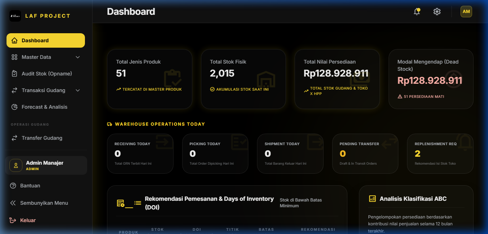

# BAB 1: DASHBOARD UTAMA WMS

## Dashboard Utama & KPI Gudang

### 1. Deskripsi Singkat
Dashboard Utama merupakan pusat kendali visual dan analisis real-time dari seluruh aktivitas inventori, kesehatan stok gudang, transaksi masuk-keluar, serta rekomendasi pengadaan barang (reorder) di WMS LAF Project. Halaman ini menyajikan indikator kinerja utama (KPI) secara konsolidasi untuk membantu pembuat keputusan dan operator gudang memantau arus barang dengan cepat.

---

### 2. Role / Hak Akses
- **Super Admin**: Akses penuh ke seluruh widget dan data KPI.
- **Admin Manajer**: Akses penuh ke seluruh widget dan data KPI.
- **Operator Gudang**: Akses ke widget stok, status operasional (receiving, picking, shipment), dan riwayat transaksi.
- **Tim Sales**: Akses ke ringkasan stok, produk menipis, dan riwayat barang keluar.
- **Tim Finance**: Akses ke nilai investasi inventori (inventory value), nilai dead stock, dan grafik penjualan.

---

### 3. Lokasi Menu (Path / URL)
- **Path Navigasi**: Sidebar Utama -> Dashboard
- **URL**: `/dashboard` (atau halaman utama `/`)

---

### 4. Alur Penggunaan (Step by Step)
1. **Pengaksesan**: Setelah login berhasil, sistem secara otomatis mengarahkan pengguna ke halaman Dashboard (`/dashboard`).
2. **Pemantauan Kartu KPI Utama**: Periksa 4 Kartu KPI di bagian atas:
   - *Total SKUs/Produk* & *Total Kuantitas Unit Stok*.
   - *Total Nilai Inventori (Asset Value)* berbasis HPP.
   - *Stok Menipis (Low Stock Alert)*.
   - *Nilai & Kuantitas Dead Stock*.
3. **Analisis Operasional Gudang**: Gulir ke panel *Operasi Gudang Hari Ini* untuk melihat jumlah *Receiving Today*, *Picking Today*, *Shipment Today*, *Pending Transfer*, dan *Rekomendasi Replenishment*.
4. **Tinjauan Rekomendasi Reorder**: Periksa tabel *Rekomendasi Pembelian Ulang (Reorder Point Alert)* untuk melihat barang yang sudah menyentuh batas minimum stok beserta perkiraan *Days of Inventory (DOI)*.
5. **Evaluasi Tren & Klasifikasi ABC**: Tinjau grafik distribusi produk kelas A, B, C dan grafik tren penjualan bulanan (*Peak Months*).
6. **Pemantauan Riwayat Transaksi Terakhir**: Lihat 5 transaksi barang masuk dan 5 transaksi barang keluar terbaru di bagian bawah halaman.

---

### 5. Penjelasan Field / Kolom / Indikator

| Nama Indikator / Widget | Tipe / Format | Keterangan & Rumus Kalkulasi | Sumber Data (Model / Tabel) |
|---|---|---|---|
| **Total Produk** | Angka Bulat | Jumlah total varian produk/SKU aktif di sistem | `mst_produk.id` (Count) |
| **Total Unit Stok** | Angka Bulat | Akumulasi kuantitas fisik stok seluruh produk | `mst_produk.total_stok` (Sum) |
| **Nilai Inventori** | Currency (Rp) | Total nilai aset persediaan = $\sum (\text{total\_stok} \times \text{hpp})$ | `mst_produk` (Sum HPP * Stok) |
| **Low Stock Count** | Angka Bulat | Jumlah SKU dengan `total_stok < minimal_stock` | `mst_produk` join `analytics_produk` |
| **Dead Stock Count & Value** | Angka & Currency (Rp) | SKU dengan `total_stok > 0` dan penjualan harian $= 0$. Nilai dead stock = $\sum (\text{total\_stok} \times \text{hpp})$ | `mst_produk` join `analytics_produk` |
| **Days of Inventory (DOI)** | Angka (Hari) | Ketahanan stok fisik dalam hari = $\lfloor \frac{\text{total\_stok}}{\text{rata\_rata\_harian}} \rfloor$ | Kalkulasi dinamis `Dashboard.php` |
| **Reorder Point (ROP)** | Angka (Unit) | Titik pemesanan ulang = $(\text{rata\_rata\_harian} \times \text{leadtime}) + \text{safety\_stock}$ | Kalkulasi dinamis `Dashboard.php` |
| **Reorder Qty Recommendation** | Angka (Unit) | Jumlah rekomendasi beli = $\max(0, \text{maximum\_stock} - \text{total\_stok})$ | Kalkulasi dinamis `Dashboard.php` |
| **Pending PO (Sisa PO)** | Angka (Unit) | Sisa unit barang yang belum diterima dari supplier | `po_detail.sisa` (Sum) |

---

### 6. Tombol & Aksi

| Nama Tombol / Link | Lokasi / Widget | Aksi & Efek ke Sistem |
|---|---|---|
| **Buat PO Baru** | Card Reorder Alert | Mengarahkan pengguna ke halaman pembuatan Purchase Order (`/purchase-order`) dengan menyertakan rekomendasi SKU. |
| **Lihat Semua Barang Masuk** | Panel Transaksi Terakhir | Mengarahkan pengguna ke halaman Transaksi Barang Masuk (`/barang-masuk`). |
| **Lihat Semua Barang Keluar** | Panel Transaksi Terakhir | Mengarahkan pengguna ke halaman Transaksi Barang Keluar (`/barang-keluar`). |

---

### 7. Validasi & Aturan Bisnis (dari Controller `Dashboard.php`)
- **Cache Optimization**: Data KPI berat (Total Produk, Nilai Inventori, Dead Stock, Klasifikasi ABC, Penjualan Bulanan) di-cache secara otomatis selama **5 menit (300 detik)** menggunakan `cache()->remember('dashboard_kpi_stats', 300, ...)` untuk menjamin performa dashboard tetap di bawah 100ms.
- **Dynamic Reorder Calculation**: Tabel rekomendasi reorder diproses secara real-time (tanpa cache) agar perubahan stok dari transaksi terbaru langsung terefleksi.
- **Fall Back DOI**: Jika penjualan harian produk bernilai `0`, DOI diberi nilai default `999` hari untuk mencegah pembagian dengan nol (*division by zero*).

---

### 8. Keterkaitan dengan Fitur Lain
- **Modul Master Data**: Mengambil data HPP, total stok, dan info produk dari `mst_produk`.
- **Modul Analytics**: Mengambil batas `minimal_stock`, `safety_stock`, `maximum_stock`, `leadtime_produksi`, dan `rata_rata_harian` dari `analytics_produk`.
- **Modul Transaksi Gudang**: Mengambil data riwayat barang masuk/keluar real-time dan sisa pesanan supplier (`po_detail`).
- **Modul Operasi Gudang**: Membaca antrean *Pending Transfer* dan rekomendasi *Replenishment Toko*.

---

### 9. Studi Kasus / Contoh Skenario
**Skenario**: Manajer Gudang ingin memeriksa barang sepatu yang kehabisan stok di tengah bulan.
1. Manajer membuka Dashboard WMS.
2. Pada tabel *Rekomendasi Pembelian Ulang*, terlihat produk `LAF-SHOE-BLK-42` memiliki sisa stok `5 pasang`, sedangkan `minimal_stock` adalah `20 pasang`.
3. Sistem menghitung DOI = `2 hari` (karena rata-rata penjualan 2.5 pasang/hari).
4. Manajer mengklik tombol *Buat PO Baru* pada rekomendasi tersebut untuk memesan `50 pasang` (sesuai rekomendasi `maximum_stock`).

---

### 10. Kemungkinan Error & Solusi

| Gejala / Pesan Error | Penyebab | Solusi Pengguna / Admin |
|---|---|---|
| Angka KPI Stok pada Dashboard tidak berubah setelah transaksi barang masuk baru. | Data KPI KPI di-cache selama 5 menit oleh sistem untuk efisiensi server. | Tunggu hingga 5 menit atau lakukan reload halaman setelah cache terkelola otomatis. |
| Nilai Reorder Point / DOI bernilai 0 atau 999. | Data analitik produk (`analytics_produk`) belum pernah dihitung atau di-generate. | Buka menu **Forecast & Analisis** (`/analytics`) lalu jalankan regenerasi data analitik. |
