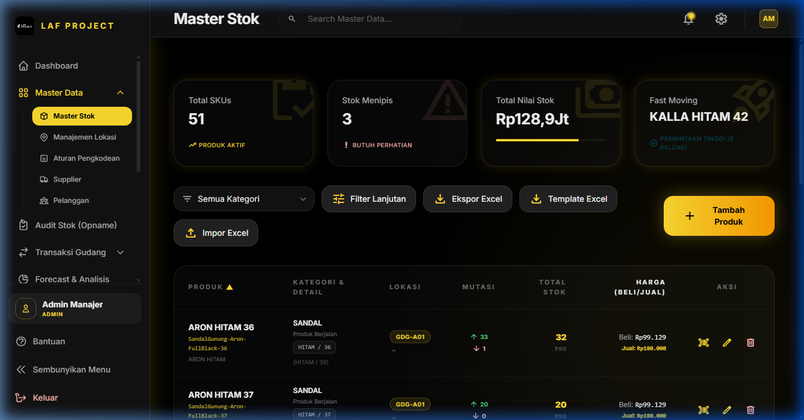
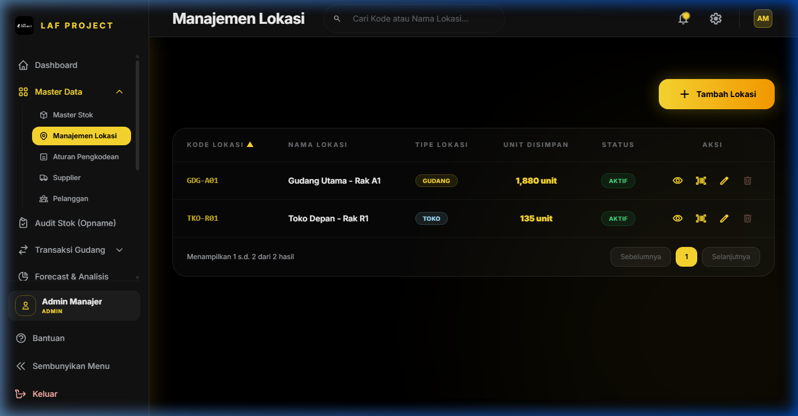
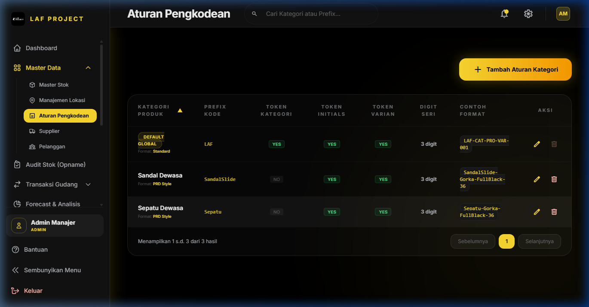
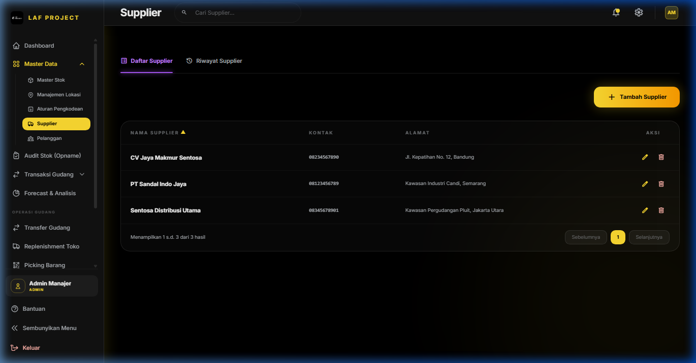

# BAB 2: MANAJEMEN MASTER DATA

## 2.1 Master Stok (Katalog Produk & Inventori)

### 1. Deskripsi Singkat
Modul Master Stok adalah pusat pengelolaan katalog produk, SKU, variasi barang (warna/ukuran), lokasi penyimpanan awal, HPP (Harga Pokok Penjualan), harga jual, serta pelacakan total stok fisik per SKU di seluruh gudang.

### 2. Role / Hak Akses
- **Melihat Data (`view master`)**: Super Admin, Admin Manajer, Operator Gudang, Tim Sales, Tim Finance.
- **Kelola Data (Tambah / Edit / Hapus / Import Excel) (`manage master`)**: Super Admin, Admin Manajer.

### 3. Lokasi Menu (Path / URL)
- **Path Navigasi**: Sidebar -> Master Data -> Master Stok
- **URL**: `/stock-master`

### 4. Alur Penggunaan (Step by Step)
1. **Melihat & Memfilter Stok**:
   - Manfaatkan bilah pencarian `search` untuk mencari berdasarkan nama barang, kode SKU, kategori, warna, atau ukuran.
   - Filter stok berdasarkan Kategori, Lokasi, Filter Ketersediaan Stok (*Low Stock*, *Out of Stock*, *In Stock*), serta Status Aktif.
2. **Menambah Produk Baru secara Manual**:
   - Klik tombol **+ Tambah Barang Baru**.
   - Isi form data produk (Nama Produk, Kategori, Variasi, Warna, Ukuran, Satuan, Lokasi, HPP, Harga Jual).
   - Centang *Generate SKU Otomatis* jika ingin sistem membuat Kode SKU berdasarkan Aturan Pengkodean, atau uncheck untuk menginput SKU kustom.
   - Klik **Simpan Data**.
3. **Mengedit / Menghapus Produk**:
   - Klik ikon **Edit (Pensil)** pada baris tabel untuk mengubah data produk.
   - Klik ikon **Hapus (Tong Sampah)** untuk menghapus SKU (hanya jika produk belum memiliki histori transaksi fisik).
4. **Export & Import Excel**:
   - Klik **Export Excel** untuk mengunduh seluruh data katalog stok dalam format XLSX.
   - Klik **Import Excel** -> Upload file template Excel -> Sistem akan memvalidasi data dan mengimpor SKU secara masal.
5. **Cetak Barcode / QR Code**:
   - Klik tombol **Barcode (Ikon Kode Bar)** pada baris produk untuk membuka modal pratinjau barcode SKU dan mengunduh / mencetaknya.

### 5. Penjelasan Field / Kolom

| Nama Field | Tipe Input | Wajib / Opsional | Keterangan & Batasan Validasi | Sumber Data / Tabel |
|---|---|---|---|---|
| `nama_produk` | Text | Wajib | Nama induk kelompok produk (maks 200 karakter) | `mst_produk.nama_produk` |
| `kategori` | Select / Text | Wajib | Kategori utama produk (misal: *Sepatu*, *Sandal*) | `mst_produk.kategori` |
| `kategori_2` | Text | Opsional | Sub-kategori atau tag sekunder | `mst_produk.kategori_2` |
| `kode_barang` | Text | Wajib (Auto) | Kode SKU unik (maks 100 karakter, Unique) | `mst_produk.kode_barang` |
| `nama_barang` | Text | Wajib | Nama spesifik barang lengkap dengan variasi | `mst_produk.nama_barang` |
| `variasi_barang`| Text | Wajib | Keterangan variasi (misal: *Hitam Size 42*) | `mst_produk.variasi_barang` |
| `warna` | Text | Opsional | Warna spesifik barang | `mst_produk.warna` |
| `size` | Text | Opsional | Ukuran/size barang (misal: *42*, *XL*) | `mst_produk.size` |
| `satuan` | Select | Wajib | Satuan kuantitas (Default: *pasang*, *pcs*, *box*) | `mst_produk.satuan` |
| `lokasi` | Select | Wajib | Kode lokasi gudang default (FK to `mst_lokasi`) | `mst_lokasi.kode_lokasi` |
| `hpp` | Number | Wajib | Harga Pokok Pembelian per unit (min: 0) | `mst_produk.hpp` |
| `harga_jual` | Number | Wajib | Harga Jual standar ke pelanggan (min: 0) | `mst_produk.harga_jual` |
| `total_stok` | System Auto | Auto | Akumulasi kuantitas stok aktual di gudang | `mst_produk.total_stok` |
| `is_active` | Toggle / Checkbox| Wajib | Status keaktifan produk dalam transaksi | `mst_produk.is_active` |

### 6. Tombol & Aksi

| Nama Tombol | Aksi & Efek ke Sistem |
|---|---|
| **+ Tambah Barang Baru** | Membuka modal form pembuatan produk baru. |
| **Import Excel** | Membuka modal upload file spreadsheet `.xlsx` / `.xls` untuk membuat SKU masal. |
| **Export Excel** | Mengunduh file Excel `products_export.xlsx` berisikan seluruh daftar stok. |
| **Download Template Import** | Mengunduh format file Excel standar untuk pengisian data import. |
| **Barcode Icon** | Membuka modal pratinjau Barcode SVG/PNG yang siap dicetak ke label printer. |
| **Simpan Data** | Memvalidasi input dan menyimpan/memperbarui data di database `mst_produk`. |

### 7. Validasi & Aturan Bisnis (Controller `StockMaster\Index.php`)
- **Auto-Generate SKU**: Jika `autoGenerateSku = true`, sistem akan merangkai Kode Barang secara otomatis berdasarkan formula di `AturanKode` (contoh: `SEPATU-LAF-BLK-42-001`).
- **Keunikan SKU**: Field `kode_barang` harus unik di dalam tabel `mst_produk`.
- **Integritas Stok Transaksi**: Total stok produk disinkronkan secara otomatis saat terjadi transaksi Barang Masuk, Barang Keluar, Transfer, atau Opname.

### 8. Keterkaitan dengan Fitur Lain
- Terhubung dengan **Manajemen Lokasi** (`mst_lokasi`) untuk lokasi penyimpanan default.
- Terhubung dengan **Aturan Pengkodean** (`mst_aturan_kode`) untuk format otomatis SKU.
- Menjadi referensi utama dalam seluruh transaksi gudang (Pembelian, Penjualan, Transfer, Opname, Picking, Packing).

### 9. Studi Kasus / Contoh Skenario
**Skenario**: Menambahkan produk baru "Sepatu Sneakers Running LAF Hitam Size 41" sejumlah 0 stok awal.
1. Buka Master Stok -> Klik **+ Tambah Barang Baru**.
2. Isi Nama Produk: "Sneakers Running LAF", Kategori: "Sepatu", Variasi: "Hitam 41", Warna: "Hitam", Size: "41", Satuan: "pasang", HPP: "150000", Harga Jual: "250000".
3. Biarkan centang *Generate SKU Otomatis* aktif -> Sistem merilis SKU `SPT-SNK-HTM-41-001`.
4. Klik **Simpan Data**. Produk kini terdaftar di sistem.

### 10. Kemungkinan Error & Solusi

| Pesan Error / Masalah | Penyebab | Solusi |
|---|---|---|
| `The kode barang has already been taken.` | Kode SKU yang dimasukkan manual sudah terdaftar di sistem. | Gunakan fitur Auto-Generate SKU atau masukkan Kode SKU lain yang unik. |
| Data pada File Import Excel gagal diproses. | Format kolom tidak sesuai dengan template atau kode lokasi tidak terdaftar di `mst_lokasi`. | Unduh ulang *Template Import*, pastikan Kode Lokasi persis sama dengan yang ada di menu Manajemen Lokasi. |

---

## 2.2 Manajemen Lokasi (Gudang & Toko)

### 1. Deskripsi Singkat
Modul Manajemen Lokasi digunakan untuk memetakan rak, bin, zona gudang (*Warehouse Sub-locations*), serta lokasi fisik toko (*Retail Outlets*). Setiap posisi penyimpanan barang teridentifikasi secara unik oleh Kode Lokasi.

### 2. Role / Hak Akses
- **Melihat Data (`view master`)**: Semua User terautentikasi.
- **Kelola Data (`manage master`)**: Super Admin, Admin Manajer.

### 3. Lokasi Menu (Path / URL)
- **Path Navigasi**: Sidebar -> Master Data -> Manajemen Lokasi
- **URL**: `/lokasi` (Detail: `/lokasi/{lokasi}/detail`)

### 4. Alur Penggunaan (Step by Step)
1. Buka halaman **Manajemen Lokasi**.
2. Klik **+ Tambah Lokasi**.
3. Isi `kode_lokasi` (misal: `GDG-A02`), `nama_lokasi` (misal: *Gudang Utama Rak A02*), dan pilih `tipe_lokasi` (*GUDANG* atau *TOKO*).
4. Klik **Simpan**.
5. Untuk melihat daftar stok spesifik pada lokasi tersebut, klik tombol **Detail Lokasi**.

### 5. Penjelasan Field / Kolom

| Nama Field | Tipe Input | Wajib / Opsional | Keterangan & Validasi |
|---|---|---|---|
| `kode_lokasi` | Text | Wajib | Kode unik lokasi (Upper Case, Unique, misal: `GDG-A01`, `TKO-R01`) |
| `nama_lokasi` | Text | Wajib | Nama deskriptif area penyimpanan (maks 200 karakter) |
| `tipe_lokasi` | Select | Wajib | Kategori tipe lokasi: `GUDANG` (Internal Warehouse) atau `TOKO` (Retail Shop) |
| `is_active` | Toggle | Wajib | Status aktif lokasi |

### 6. Validasi & Aturan Bisnis (Controller `Lokasi\Index.php`)
- **Proteksi Default System**: Kode lokasi default `GDG-A01` dan `TKO-R01` **TIDAK BOLEH DIDELETE atau DIUBAH KODENYA** karena digunakan sebagai fallback sistem untuk transaksi dasar dan pengisian stok otomatis.

---

## 2.3 Aturan Pengkodean (Auto SKU Generator)

### 1. Deskripsi Singkat
Fitur Aturan Pengkodean memungkinkan Admin mengonfigurasi pola pembentukan kode SKU otomatis berdasarkan kombinasi Kategori, Inisial Nama Barang, Kode Variasi/Warna/Size, serta Angka Urut (*Auto-Increment Digits*).

### 2. Role / Hak Akses
- **Kelola Data (`manage master`)**: Super Admin, Admin Manajer.

### 3. Lokasi Menu (Path / URL)
- **Path Navigasi**: Sidebar -> Master Data -> Aturan Pengkodean
- **URL**: `/pengkodean`

### 4. Penjelasan Field & Format Pengkodean

| Nama Field | Tipe Input | Keterangan & Contoh Efek |
|---|---|---|
| `kategori` | Select / Text | Kategori spesifik aturan (kosongkan untuk aturan *Default Global*) |
| `prefix` | Text | Prefix kustom depan SKU (misal: `LAF`, `PRD`) |
| `include_category_prefix` | Toggle | Memasukkan 3 huruf depan kategori (contoh: `SEPATU` -> `SPT`) |
| `include_product_initials`| Toggle | Memasukkan inisial dari nama produk (contoh: `Running Shoes` -> `RS`) |
| `include_variant_code` | Toggle | Memasukkan kode warna/size di SKU |
| `increment_digits` | Number | Jumlah digit nomor urut belakang (contoh: `3` -> `001`, `4` -> `0001`) |
| `format_tipe` | Select | Pola penomoran: `INCREMENT` (Numerik Urut) atau `PRD_STYLE` (Format Gaya Produk LAF) |

---

## 2.4 Master Data Supplier & Pelanggan

### 1. Deskripsi Singkat
Mengelola database entitas eksternal perusahaan: **Supplier** (Pemasok barang/vendor untuk transaksi Purchase Order & Barang Masuk) dan **Pelanggan** (Customer/Mitra pembeli untuk transaksi Barang Keluar).

### 2. Role / Hak Akses
- **Melihat & Riwayat (`view master`)**: Semua User terautentikasi.
- **Kelola Data (`manage master`)**: Super Admin, Admin Manajer.

### 3. Lokasi Menu (Path / URL)
- **Supplier**: `/supplier` (Riwayat Transaksi: `/supplier/riwayat`)
- **Pelanggan**: `/pelanggan` (Riwayat Transaksi: `/pelanggan/riwayat`)

### 4. Penjelasan Field Data (Supplier & Pelanggan)

| Nama Field | Tipe Input | Wajib / Opsional | Keterangan |
|---|---|---|---|
| `kode_supplier` / `kode_pelanggan` | Text | Wajib | Kode Unik identitas mitra (misal: `SUP-001`, `CUST-001`) |
| `nama_supplier` / `nama_pelanggan` | Text | Wajib | Nama resmi perusahaan atau perorangan |
| `kontak` / `telepon` | Text | Opsional | Nomor HP / WhatsApp aktif |
| `email` | Email | Opsional | Alamat email korespondensi |
| `alamat` | Textarea | Opsional | Alamat lengkap domisili / pengiriman |
