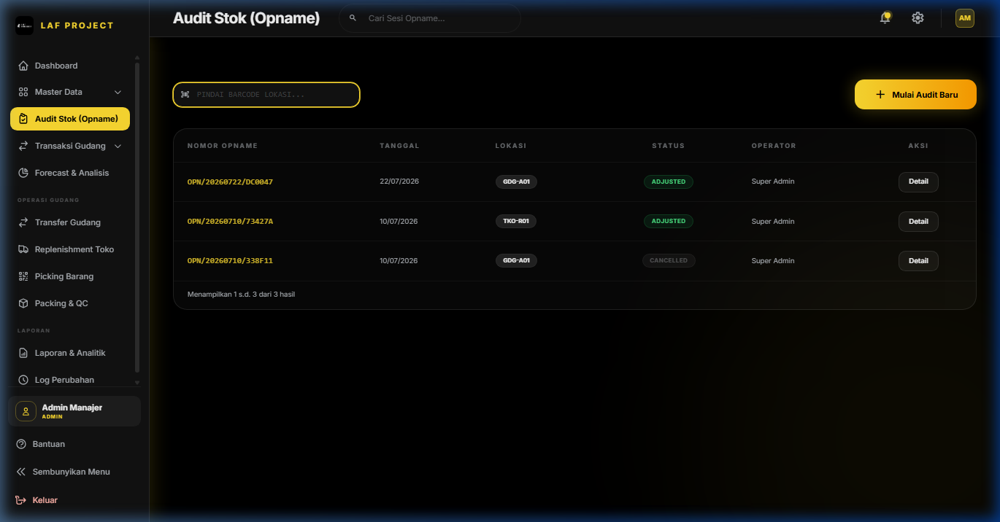

# BAB 3: AUDIT STOK & OPNAME

## Audit Stok (Opname Inventori & Stock Adjustment)

### 1. Deskripsi Singkat
Modul Audit Stok (Stock Opname) adalah fitur verifikasi fisik persediaan barang di gudang/toko untuk mencocokkan jumlah stok fisik nyata (*Physical Count*) dengan catatan stok sistem (*System Count*). Fitur ini secara otomatis menghitung selisih (varian) dan memperbarui stok lokasi secara akurat saat sesi audit disahkan (*POSTED*).

---

### 2. Role / Hak Akses
- **Membuat & Mengisi Audit (`input masuk`)**: Super Admin, Admin Manajer, Operator Gudang.
- **Mengesahkan Penyesuaian Stok (Approve / Post Opname)**: Super Admin, Admin Manajer, Operator Gudang.
- **Membatalkan Sesi Audit**: Super Admin, Admin Manajer.

---

### 3. Lokasi Menu (Path / URL)
- **Path Navigasi**: Sidebar -> Audit Stok (Opname)
- **URL**: `/audit`

---

### 4. Alur Penggunaan (Step by Step)

#### **A. Membuka Sesi Audit Baru (DRAFT)**
1. Masuk ke menu **Audit Stok (Opname)**.
2. Klik tombol **+ Sesi Audit Baru** (atau gunakan Barcode Scanner untuk memindai Barcode Lokasi gudang seperti `GDG-A01`).
3. Pilih **Tanggal Audit**, pilih **Lokasi Gudang / Toko** yang akan diaudit, dan beri catatan pada kolom **Keterangan**.
4. Klik **Mulai Audit**. Sistem secara otomatis merilis Nomor Opname unik (misal: `OPN/20260818/A1F9`) dan memuat seluruh produk yang terdaftar di lokasi tersebut dengan `qty_sistem` awal.

#### **B. Penginputan Hasil Hitung Fisik (Physical Count)**
Ada 2 cara penginputan fisik:
- **Cara 1: Pemindaian Barcode (Metode Cepat Scanner Handheld)**
  1. Arahkan kursor ke input **Scan QR / Barcode Produk**.
  2. Pindai label SKU produk dengan scanner. Setiap kali dipindai, jumlah `qty_fisik` produk tersebut bertambah `+1` secara otomatis dan suara *beep* berbunyi.
- **Cara 2: Pengisian Manual pada Lembar Kerja**
  1. Pada tabel lembar kerja audit, cari nama barang/SKU yang dimaksud.
  2. Ketik jumlah stok fisik yang dihitung di kolom **Stok Fisik**.
  3. Sistem secara otomatis menghitung `Selisih = Stok Fisik - Stok Sistem`.

#### **C. Pengesahan Audit & Penyesuaian Stok (POSTED)**
1. Setelah seluruh barang dihitung, periksa ringkasan varian (Selisih Positif / Selisih Negatif).
2. Klik tombol **Sahkan & Post Opname (Sesuaikan Stok)**.
3. Konfirmasikan dialog persetujuan.
4. **Efek Sistem**:
   - Status sesi audit berubah menjadi `POSTED`.
   - Stok fisik pada tabel `trx_stok_lokasi` dan `mst_produk.total_stok` langsung disesuaikan secara otomatis.
   - Sistem mencatat jurnal mutasi lokasi (`trx_mutasi_lokasi`) dengan tipe `ADJUSTMENT` untuk kebutuhan audit trail.

---

### 5. Penjelasan Field / Kolom

| Nama Field | Tipe Input | Wajib / Opsional | Keterangan & Batasan | Tabel Database |
|---|---|---|---|---|
| `nomor_opname` | System Auto | Auto | Nomor referensi unik sesi audit (contoh: `OPN/20260818/B3C2`) | `trx_opname_header.nomor_opname` |
| `tanggal` | Date | Wajib | Tanggal pelaksanaan opname fisik | `trx_opname_header.tanggal` |
| `lokasi_id` | Select | Wajib | Lokasi spesifik yang diaudit (FK to `mst_lokasi`) | `trx_opname_header.lokasi_id` |
| `status` | System | Auto | Status Sesi: `DRAFT` (Sedang berjalan) atau `POSTED` (Disahkan) | `trx_opname_header.status` |
| `barcodeScan` | Text / Scan | Opsional | Input cepat pemindaian barcode lokasi atau barcode SKU | Temporary State |
| `qty_sistem` | Read-only | Auto | Kuantitas stok di sistem saat sesi audit dibuka | `trx_opname_detail.qty_sistem` |
| `qty_fisik` | Number | Wajib | Kuantitas aktual hasil perhitungan fisik petugas | `trx_opname_detail.qty_fisik` |
| `selisih` | Read-only | Auto | Selisih varian = `qty_fisik` - `qty_sistem` | `trx_opname_detail.selisih` |

---

### 6. Tombol & Aksi

| Nama Tombol | Aksi & Efek ke Sistem |
|---|---|
| **+ Sesi Audit Baru** | Membuka form modal inisiasi sesi opname lokasi baru. |
| **Sahkan & Post Opname** | Mengunci sesi opname (status `POSTED`) dan memperbarui stok aktual di database. |
| **Batal / Hapus Sesi DRAFT** | Membatalkan sesi DRAFT tanpa mengubah stok di database. |
| **Reset ke Stok Sistem** | Mengembalikan seluruh `qty_fisik` sama dengan `qty_sistem` pada lembar kerja. |

---

### 7. Validasi & Aturan Bisnis (Controller `Audit\Index.php`)
- **Pencegahan Sesi Ganda**: Tidak diperbolehkan membuat sesi audit `DRAFT` baru pada lokasi yang sama jika lokasi tersebut masih memiliki sesi audit `DRAFT` yang belum disahkan. Sistem akan secara otomatis mengarahkan ke sesi `DRAFT` yang ada.
- **Proteksi Pengesahan**: Sesi audit yang sudah berstatus `POSTED` terkunci secara permanen dan tidak dapat diubah atau dihapus.
- **Pencatatan Mutasi**: Setiap penyesuaian stok dari opname menghasilkan record `MutasiLokasi` dengan reference ID opname untuk transparansi pemeriksaan akuntan/auditor.

---

### 8. Keterkaitan dengan Fitur Lain
- **Manajemen Lokasi**: Menentukan area fisik rak/gudang yang diaudit.
- **Master Stok**: Memperbarui kolom `total_stok` pada `mst_produk`.
- **Log Perubahan (Audit Log)**: Mencatat identitas operator dan waktu pengesahan penyesuaian stok opname.

---

### 9. Studi Kasus / Contoh Skenario
**Skenario**: Opname bulanan Rak Gudang `GDG-A01`.
1. Petugas memilih lokasi `GDG-A01` -> Klik **Mulai Audit**.
2. Pada barang `LAF-SHOE-BLK-40`, stok sistem mencatat `10 pasang`.
3. Setelah dihitung fisik, ternyata hanya ada `8 pasang` (hilang 2 pasang). Petugas mengisi `Stok Fisik = 8`.
4. Kolom selisih menampilkan `-2` (berwarna merah).
5. Petugas mengklik **Sahkan & Post Opname**. Stok di gudang `GDG-A01` langsung berkurang dari `10` menjadi `8 pasang`, dan jurnal penyesuaian `-2 pasang` tercatat di log audit.

---

### 10. Kemungkinan Error & Solusi

| Pesan Error / Masalah | Penyebab | Solusi |
|---|---|---|
| `Barcode lokasi tidak cocok dengan lokasi sesi audit saat ini.` | Petugas memindai kode lokasi lain di tengah-tengah sesi audit aktif. | Pastikan memindai produk yang ada pada lokasi yang sedang dibuka, atau kembali ke menu utama untuk membuka sesi lokasi lain. |
| Tombol *Sahkan & Post Opname* tidak dapat diklik / diabaikan. | Terdapat nilai stok fisik negatif atau format input bukan angka. | Periksa lembar kerja, pastikan semua kolom stok fisik terisi dengan angka desimal/bulat non-negatif ($\ge 0$). |
