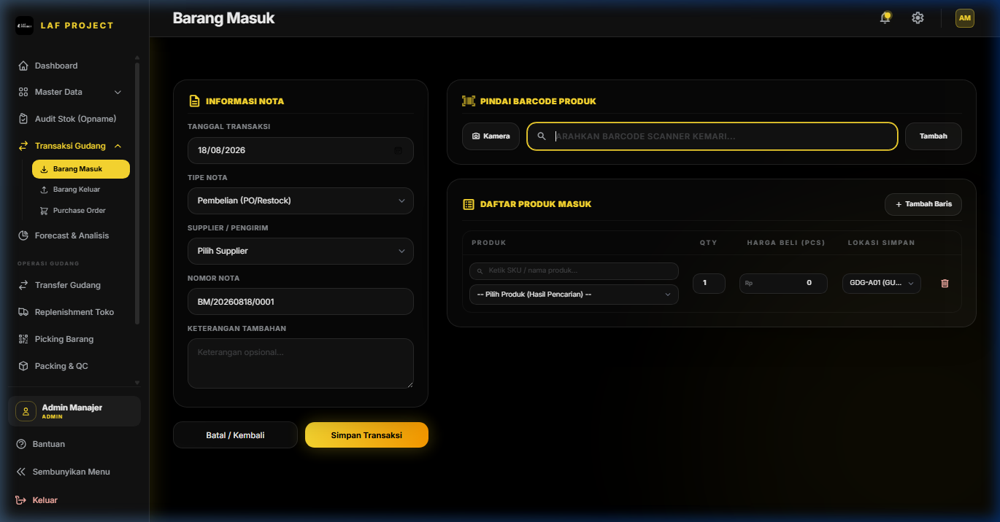
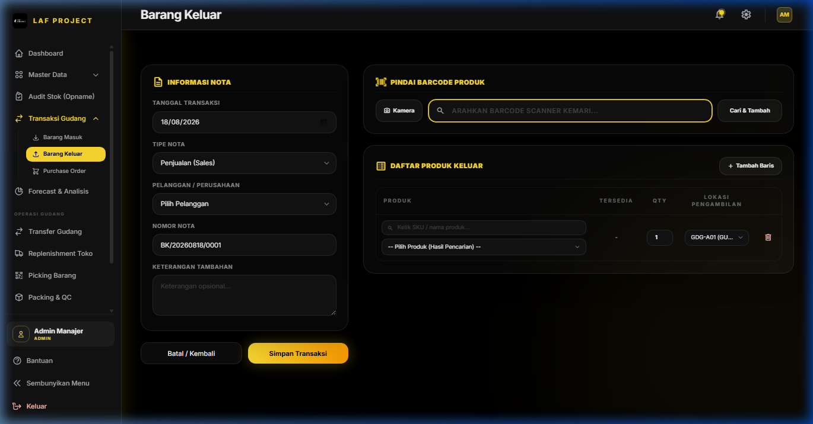
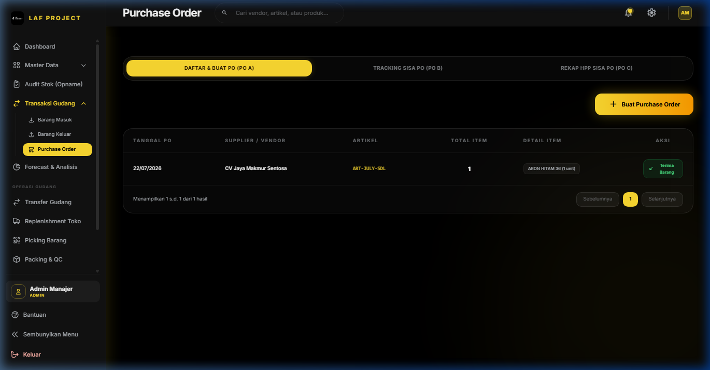

# BAB 4: TRANSAKSI GUDANG



## 4.1 Barang Masuk (Inbound / Receiving)

### 1. Deskripsi Singkat
Modul Barang Masuk digunakan untuk mencatat penerimaan persediaan barang baru ke gudang, baik yang berasal dari transaksi **Pembelian Supplier**, penerimaan dari **Purchase Order (PO)**, **Stock Awal**, **Retur Masuk**, maupun **Penyesuaian Transaksi**.

### 2. Role / Hak Akses
- **Akses Transaksi Masuk (`input masuk`)**: Super Admin, Admin Manajer, Operator Gudang.

### 3. Lokasi Menu (Path / URL)
- **Path Navigasi**: Sidebar -> Transaksi Gudang -> Barang Masuk
- **URL**: `/barang-masuk` (Buat Baru: `/barang-masuk/create`, Edit: `/barang-masuk/{id}/edit`, Riwayat: `/barang-masuk/riwayat`)

### 4. Alur Penggunaan (Step by Step)
1. Buka menu **Barang Masuk** -> Klik **+ Tambah Barang Masuk**.
2. Sistem membuat **Nomor Nota** otomatis (contoh: `BM/20260818/001`).
3. Pilih **Tipe Nota**: `Pembelian`, `Stock Awal`, `Retur Masuk`, atau `Penyesuaian`.
4. Pilih **Supplier** pengirim barang (Wajib untuk Pembelian/Retur).
5. **Tambahkan Item Barang**:
   - *Pilihan A (Manual)*: Ketik nama barang/SKU -> Pilih Produk -> Tentukan `Kuantitas Masuk`, `Lokasi Simpan`, dan `HPP / Harga Beli`.
   - *Pilihan B (Scanner Barcode)*: Pindai barcode produk pada input scan -> Item langsung ditambahkan ke tabel dengan kuantitas +1.
   - *Pilihan C (Dari Purchase Order)*: Jika transaksi berasal dari PO, sistem akan memuat otomatis item yang dipesan beserta sisa kuantitas PO-nya (`po_detail_id`).
6. Klik **Simpan Transaksi**.
7. **Efek Sistem**:
   - Kuantitas stok produk di `mst_produk.total_stok` bertambah.
   - Kuantitas stok spesifik lokasi di `trx_stok_lokasi` bertambah.
   - Jika terhubung PO, `po_detail.sisa` dan `po_detail.diterima` diperbarui (sisa PO berkurang).
   - Jurnal mutasi lokasi terbit secara otomatis.

### 5. Penjelasan Field Header & Detail (Tabel Data)

| Nama Field | Tipe Input | Wajib / Opsional | Keterangan & Validasi |
|---|---|---|---|
| `tanggal` | Date | Wajib | Tanggal penerimaan barang |
| `tipe_nota` | Select | Wajib | Pilihan: `Stock Awal`, `Pembelian`, `Retur Masuk`, `Penyesuaian` |
| `supplier_id` | Select | Wajib* | Supplier pengirim (*Opsional hanya jika Tipe Nota = Stock Awal) |
| `nomor_nota` | Text | Wajib | Kode Nota unik (Auto-generated: `BM/YYYYMMDD/XXX`) |
| `keterangan_tambahan` | Textarea | Opsional | Catatan tambahan seperti nomor surat jalan supplier |
| `items.*.produk_id` | Select / Scan | Wajib | SKU/Produk yang diterima |
| `items.*.qty_masuk` | Number | Wajib | Jumlah unit masuk (Integer $\ge 1$) |
| `items.*.lokasi_simpan`| Select | Wajib | Kode lokasi rak tujuan barang disimpan (misal: `GDG-A01`) |
| `items.*.hpp` | Number | Wajib | Harga beli / modal per unit ($\ge 0$) |

---



## 4.2 Barang Keluar (Outbound / Dispatch)

### 1. Deskripsi Singkat
Modul Barang Keluar digunakan untuk mengoperasikan pengeluaran stok fisik dari gudang, meliputi pengiriman penjualan ke **Pelanggan**, **Penjualan Langsung**, **Retur Keluar**, maupun **Penyesuaian Outbound**.

### 2. Role / Hak Akses
- **Akses Transaksi Keluar (`input keluar`)**: Super Admin, Admin Manajer, Operator Gudang, Tim Sales.

### 3. Lokasi Menu (Path / URL)
- **Path Navigasi**: Sidebar -> Transaksi Gudang -> Barang Keluar
- **URL**: `/barang-keluar` (Buat Baru: `/barang-keluar/create`, Riwayat: `/barang-keluar/riwayat`)

### 4. Alur Penggunaan (Step by Step)
1. Buka menu **Barang Keluar** -> Klik **+ Tambah Barang Keluar**.
2. Sistem menerbitkan **Nomor Nota Outbound** otomatis (contoh: `BK/20260818/001`).
3. Pilih **Pelanggan** (Customer/Mitra).
4. Tambahkan item barang yang dikeluarkan, tentukan **Lokasi Asal Ambil** dan **Kuantitas Keluar**.
5. **Validasi Stok**: Sistem secara otomatis mengecek ketersediaan stok aktual di lokasi tersebut. Jika `qty_keluar > stok_tersedia`, transaksi ditolak dengan pesan peringatan.
6. Klik **Simpan Transaksi**.
7. **Efek Sistem**:
   - Total stok produk di `mst_produk.total_stok` dan `trx_stok_lokasi` berkurang.
   - Terbit dokumen transaksi pengeluaran dan struk/faktur pengiriman yang siap dicetak.

---



## 4.3 Purchase Order (PO Supplier)

### 1. Deskripsi Singkat
Modul Purchase Order (PO) adalah sistem manajemen pemesanan pembelian barang resmi kepada supplier sebelum barang dikirim/diterima di gudang. Modul ini melacak status penerimaan barang parsial hingga PO dinyatakan selesai (*CLOSED*).

### 2. Role / Hak Akses
- **Melihat PO (`view po`)**: Semua User terautentikasi.
- **Membuat & Mengelola PO (`manage po`)**: Super Admin, Admin Manajer, Tim Sales.

### 3. Lokasi Menu (Path / URL)
- **Path Navigasi**: Sidebar -> Transaksi Gudang -> Purchase Order
- **URL**: `/purchase-order`

### 4. Penjelasan Status & Workflow PO

```
[ DRAFT ] ➔ [ APPROVED / ORDERED ] ➔ [ PARTIAL ] ➔ [ RECEIVED / CLOSED ]
```

1. **DRAFT / ORDERED**: PO baru dibuat dan dikirim ke Supplier.
2. **PARTIAL**: Barang dari supplier diterima sebagian di gudang melalui menu *Barang Masuk*.
3. **RECEIVED / CLOSED**: Seluruh kuantitas barang dalam PO telah diterima 100% di gudang (`sisa = 0`).

### 5. Penjelasan Field Utama PO

| Nama Field | Tipe Input | Keterangan |
|---|---|---|
| `nomor_po` | System Auto | Nomor PO unik (contoh: `PO/20260818/001`) |
| `supplier_id` | Select | Supplier tujuan pemesanan |
| `tanggal_po` | Date | Tanggal penerbitan pesanan |
| `target_tanggal` | Date | Target estimasi barang tiba di gudang |
| `qty_pesan` | Number | Kuantitas total dipesan ke supplier |
| `qty_diterima` | Auto | Kuantitas yang sudah sampai di gudang |
| `sisa` | Auto | Sisa kuantitas PO yang belum dikirim (`qty_pesan - qty_diterima`) |
