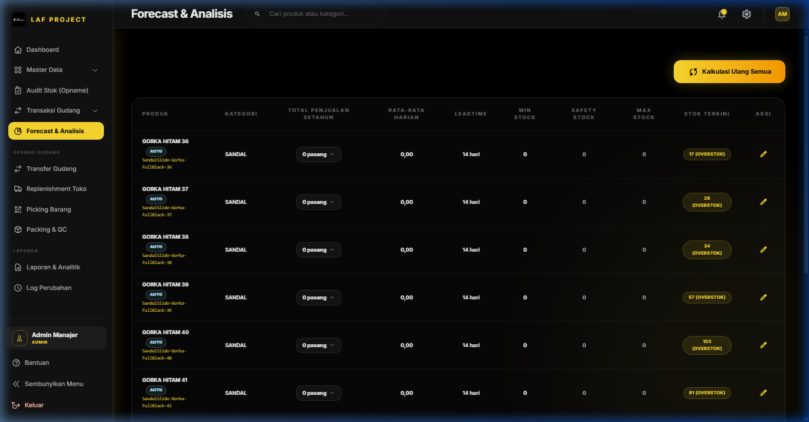

# BAB 5: FORECAST & ANALISIS INVENTORI

## Forecast & Analisis Inventori (ABC Analysis, ROP, & Demand Forecasting)

### 1. Deskripsi Singkat
Modul Forecast & Analisis adalah kecerdasan buatan dan engine analitik internal WMS LAF Project yang menghitung Klasifikasi ABC (Prinsip Pareto 80/20), Peramalan Permintaan (*Demand Forecasting*), *Safety Stock*, *Minimal Stock*, *Maximum Stock*, serta *Reorder Point (ROP)* secara otomatis berdasarkan data historis penjualan atau input manual pengguna.

---

### 2. Role / Hak Akses
- **Melihat & Edit Analisis (`view analytics`)**: Super Admin, Admin Manajer, Tim Finance.

---

### 3. Lokasi Menu (Path / URL)
- **Path Navigasi**: Sidebar -> Forecast & Analisis
- **URL**: `/analytics`

---

### 4. Alur Penggunaan (Step by Step)
1. Buka menu **Forecast & Analisis**.
2. **Lihat Hasil Klasifikasi ABC & Matriks Stok**:
   - **Kelas A (High-Value / Fast-Moving)**: 20% SKU teratas yang menyumbang ~80% dari total nilai penjualan.
   - **Kelas B (Moderate-Value)**: 30% SKU berikutnya yang menyumbang ~15% penjualan.
   - **Kelas C (Low-Value / Slow-Moving)**: 50% SKU terbawah yang hanya menyumbang ~5% penjualan.
3. **Regenerasi Perhitungan Otomatis**:
   - Klik tombol **Hitung Ulang Analisis (Recalculate All)** untuk menjalankan kalkulasi statistik ulang terhadap seluruh produk berdasarkan transaksi penjualan terbaru dari database.
4. **Mengubah Parameter per Produk**:
   - Klik ikon **Edit (Pensil)** pada baris SKU yang diinginkan.
   - Sesuaikan **Leadtime Produksi / Pengiriman (hari)** (default: 14 hari).
   - Tentukan apakah akan menggunakan *Hitung Otomatis* dari tren bulanan atau mengaktifkan *Override Stok Manual* (`is_manual_stock`).
   - Klik **Tarik Data Aktual** jika ingin mengambil angka riwayat transaksi dari database secara instan.
   - Klik **Simpan Analisis**.

---

### 5. Formulasi Matematika & Aturan Kalkulasi

| Variabel Analisis | Formulasi Matematika | Keterangan Bisnis |
|---|---|---|
| **Rata-Rata Penjualan Harian** | $D_{daily} = \frac{\sum_{m=1}^{12} \text{penjualan}_m}{365}$ | Rerata unit terjual per hari dalam 1 tahun |
| **Standar Deviasi Harian** | $\sigma_{daily} = \sqrt{\frac{\sum (\text{penjualan}_m - \text{mean})^2}{12}} \div \sqrt{30}$ | Variabilitas / fluktuasi permintaan |
| **Safety Stock (Stok Pengaman)** | $SS = Z \times \sigma_{daily} \times \sqrt{L}$ | Stok cadangan mengantisipasi lonjakan ($Z=1.65$ untuk Service Level 95%, $L = \text{Leadtime}$) |
| **Reorder Point (ROP)** | $ROP = (D_{daily} \times L) + SS$ | Batas kuantitas saat PO harus diterbitkan |
| **Minimal Stock** | $Min = ROP$ | Batas ambang bawah persediaan aman |
| **Maximum Stock** | $Max = ROP + (D_{daily} \times 30)$ | Batas ambang atas pencegahan *overstock* |

---

### 6. Penjelasan Field Modal Edit Analisis

| Nama Field | Tipe Input | Wajib / Opsional | Keterangan & Validasi |
|---|---|---|---|
| `leadtime_produksi` | Number | Wajib | Waktu tunggu dari PO diterbitkan hingga barang masuk gudang (1 - 365 hari) |
| `is_manual_stock` | Toggle | Wajib | Aktifkan jika ingin menentukan batas Min/Safety/Max stock secara manual |
| `minimal_stock` | Number | Wajib (jika manual) | Batas stok minimum manual ($\ge 0$) |
| `safety_stock` | Number | Wajib (jika manual) | Stok pengaman manual ($\ge 0$) |
| `maximum_stock` | Number | Wajib (jika manual) | Batas stok maksimal manual ($\ge 0$) |
| `sales.jan` s/d `des` | Number | Wajib | Histori volume penjualan dari Januari hingga Desember ($\ge 0$) |

---

### 7. Tombol & Aksi

| Nama Tombol | Aksi & Efek ke Sistem |
|---|---|
| **Hitung Ulang Analisis (Recalculate All)** | Menjalankan `AnalyticsService::recalculateAllProductAnalytics()` untuk memperbarui seluruh parameter ABC, ROP, Min, Max, dan Safety Stock seluruh SKU. |
| **Tarik Data Aktual (Sync from Database)** | Menghitung dan mengisi angka penjualan bulanan dari tabel `trx_barang_keluar_detail` aktual. |
| **Simpan Analisis** | Memperbarui parameter analitik SKU di tabel `analytics_produk`. |

---

### 8. Keterkaitan dengan Fitur Lain
- **Dashboard Utama**: Menyuplai data indikator *Low Stock Alert*, *Dead Stock*, *Peak Months*, dan rekomendasi kuantitas *Reorder*.
- **Purchase Order (PO)**: Rekomendasi kuantitas pesan otomatis merujuk pada `maximum_stock - total_stok`.
- **Replenishment Toko**: Menggunakan `minimal_stock` sebagai dasar pemicu pengisian kembali barang dari Gudang ke Toko.
