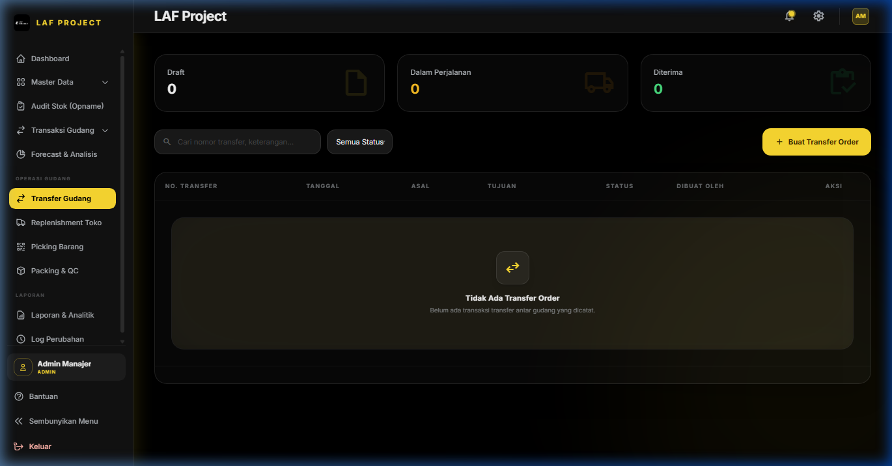
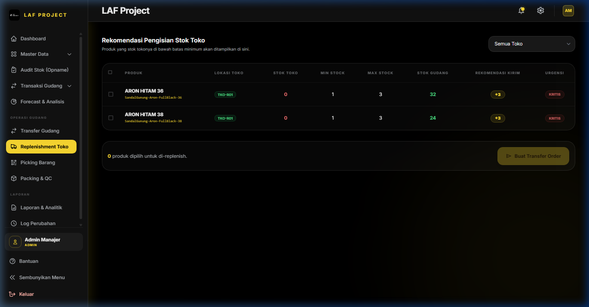
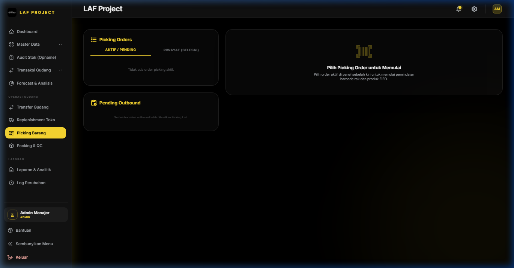
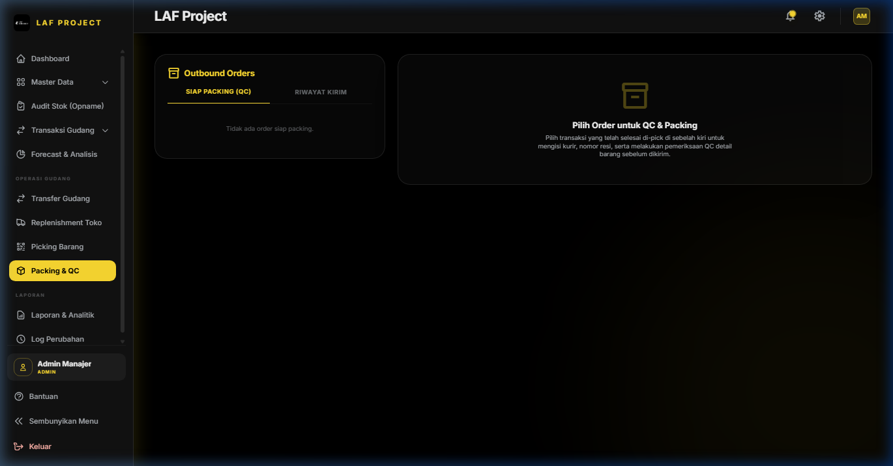

# BAB 6: OPERASI GUDANG



## 6.1 Transfer Gudang (Internal Warehouse Transfer)

### 1. Deskripsi Singkat
Modul Transfer Gudang mengelola perpindahan fisik stok barang antar-lokasi internal (misalnya dari *Gudang Utama GDG-A01* ke *Gudang Transit GDG-B01* atau ke *Toko TKO-R01*). Modul ini menjamin transparansi posisi stok selama proses perpindahan barang berlangsung (*In-Transit Tracking*).

### 2. Role / Hak Akses
- **Akses Transfer Gudang (`input masuk`)**: Super Admin, Admin Manajer, Operator Gudang.

### 3. Lokasi Menu (Path / URL)
- **Path Navigasi**: Sidebar -> Operasi Gudang -> Transfer Gudang
- **URL**: `/transfer` (Buat Baru: `/transfer/create`, Detail: `/transfer/{transfer}/detail`)

### 4. Alur & Siklus Status Transfer Gudang

```
[ DRAFT ] ➔ [ PICKING ] ➔ [ IN_TRANSIT ] ➔ [ COMPLETED ]
```

1. **DRAFT**: Dokumen perintah transfer dibuat oleh Admin/Operator.
2. **PICKING**: Petugas gudang mengambil barang dari lokasi asal (terhubung ke modul Picking List).
3. **IN_TRANSIT**: Barang telah keluar dari lokasi asal dan dalam perjalanan menuju lokasi tujuan (stok dikurangi dari lokasi asal).
4. **COMPLETED**: Barang telah sampai dan diterima secara fisik di lokasi tujuan (stok ditambahkan ke lokasi tujuan).

---



## 6.2 Replenishment Toko (Store Stock Replenishment)

### 1. Deskripsi Singkat
Replenishment Toko adalah sistem pengisian kembali persediaan toko ritel otomatis. Engine rekomendasi mendeteksi produk di toko yang jumlah stoknya telah berada di bawah *Minimal Stock* dan memicu pengiriman stok dari gudang utama ke lokasi toko.

### 2. Role / Hak Akses
- **Akses Replenishment (`input masuk`)**: Super Admin, Admin Manajer, Operator Gudang.

### 3. Lokasi Menu (Path / URL)
- **Path Navigasi**: Sidebar -> Operasi Gudang -> Replenishment Toko
- **URL**: `/replenishment`

### 4. Alur Penggunaan
1. Buka menu **Replenishment Toko**.
2. Sistem secara otomatis menampilkan daftar SKU di Toko yang membutuhkan pengisian persediaan beserta **Rekomendasi Qty Kirim**.
3. Centang item produk yang ingin diisi kembali -> Klik **Buat Dokumen Transfer Replenishment**.
4. Dokumen Transfer Gudang diterbitkan secara otomatis dari `GDG-A01` menuju `TKO-R01`.

---



## 6.3 Picking Barang (Order Picking & Barcode Verification)

### 1. Deskripsi Singkat
Modul Picking Barang memandu petugas gudang dalam proses pengambilan barang dari lokasi rak (*Bin/Shelf Location*) untuk memenuhi pesanan Barang Keluar atau Transfer Gudang. Modul ini dilengkapi verifikasi barcode scanner untuk mencegah salah ambil barang (*Zero Picking Error*).

### 2. Role / Hak Akses
- **Akses Picking (`input keluar` / `input masuk`)**: Super Admin, Admin Manajer, Operator Gudang, Tim Sales.

### 3. Lokasi Menu (Path / URL)
- **Path Navigasi**: Sidebar -> Operasi Gudang -> Picking Barang
- **URL**: `/picking`

### 4. Alur Penggunaan (Step by Step)
1. Buka halaman **Picking Barang**.
2. Pilih antrean pesanan pada tab **Pending Outbound** -> Klik **Mulai Picking**.
3. Petugas gudang menuju lokasi rak yang tertera pada lembar instruksi picking.
4. **Verifikasi Barcode**:
   - Pindai barcode rak lokasi (misal: `GDG-A01`).
   - Pindai barcode SKU barang (misal: `LAF-SHOE-BLK-42`).
   - Masukkan kuantitas yang diambil -> Klik **Verifikasi Item**.
5. Setelah seluruh item dalam daftar terambil 100%, klik **Selesaikan Picking**. Status pesanan berubah menjadi `PICKED` dan siap untuk diproses ke modul Packing & QC.

---



## 6.4 Packing & QC (Packaging & Quality Control)

### 1. Deskripsi Singkat
Modul Packing & QC adalah tahap verifikasi akhir sebelum barang dikemas dalam koli/kardus dan diserahkan ke jasa kurir/pengirim. Petugas melakukan inspeksi fisik barang, pengemasan, dan pencetakan Label Pengiriman / Resi (*Shipping Label*).

### 2. Role / Hak Akses
- **Akses Packing & QC (`input keluar`)**: Super Admin, Admin Manajer, Operator Gudang, Tim Sales.

### 3. Lokasi Menu (Path / URL)
- **Path Navigasi**: Sidebar -> Operasi Gudang -> Packing & QC
- **URL**: `/packing`

### 4. Alur Penggunaan
1. Buka menu **Packing & QC**.
2. Pilih pesanan berstatus `PICKED` -> Klik **Mulai Packing & QC**.
3. Pindai ulang barcode produk untuk memastikan barang tidak cacat dan sesuai dengan pesanan.
4. Masukkan dimensi berat/koli kardus -> Klik **Selesai Packing & Cetak Label Pengiriman**.
5. Tempelkan label pengiriman pada kardus kemasan.
