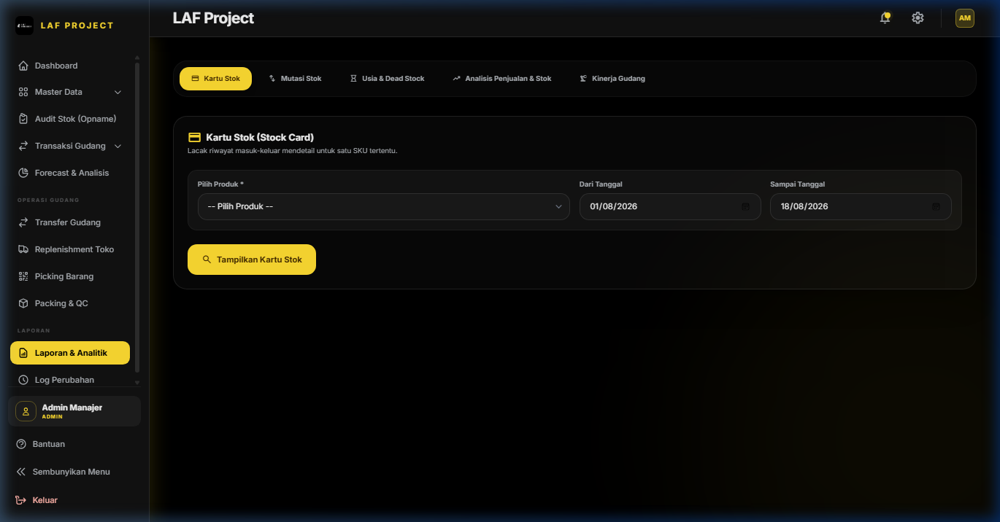

# BAB 7: LAPORAN & AUDIT LOG

## 7.1 Laporan & Analitik (Reports & Financial Statements)

### 1. Deskripsi Singkat
Modul Laporan & Analitik menyajikan rangkuman data eksekutif mencakup Laporan Nilai Aset Inventori, Laporan Mutasi Stok Masuk & Keluar, Analisis Profitabilitas/Margin HPP vs Harga Jual, serta Laporan Transaksi Per Periode Tanggal.

### 2. Role / Hak Akses
- **Akses Laporan (`view financial`)**: Super Admin, Admin Manajer, Tim Finance.

### 3. Lokasi Menu (Path / URL)
- **Path Navigasi**: Sidebar -> Laporan -> Laporan & Analitik
- **URL**: `/reports` (Format Cetak PDF: `/reports/print`)

### 4. Jenis-Jenis Laporan yang Tersedia
1. **Laporan Nilai Persediaan (Inventory Valuation Report)**: Rincian total nilai aset produk berbasis HPP per lokasi gudang.
2. **Laporan Mutasi Stok (Stock Movement Summary)**: Rekapitulasi volume stok awal, stok masuk, stok keluar, dan stok akhir.
3. **Laporan Penjualan & Margin Keuntungan**: Analisis omzet penjualan, modal HPP, dan gross profit per varian barang.
4. **Laporan Transaksi Barang Masuk & Keluar Per Periode**: Rekap harian/bulanan dengan filter rentang tanggal.

### 5. Fitur Ekspor & Cetak
- **Ekspor Excel (.xlsx)**: Mengunduh dataset laporan dalam bentuk spreadsheet untuk diolah lebih lanjut.
- **Cetak Dokumen PDF**: Membuka tampilan mode cetak ramah printer (*Print Friendly*) lengkap dengan Kop Surat Perusahaan LAF Project dan kolom tanda tangan pengesahan.

---

[SCREENSHOT: audit-log-index - Halaman Audit Log Sistem Penelusuran Jejak Aktivitas User]

## 7.2 Log Perubahan (System Audit Log)

### 1. Deskripsi Singkat
Modul Log Perubahan adalah sistem pencatat jejak audit (*Audit Trail*) independen yang merekam seluruh perubahan data sensitif, aktivitas pembuat data, penyuntingan, penghapusan, IP Address, dan perubahan nilai kolom (*Old Values* vs *New Values*) di dalam database WMS.

### 2. Role / Hak Akses
- **Akses Log Perubahan (`manage system` / `manage master`)**: Super Admin, Admin Manajer.

### 3. Lokasi Menu (Path / URL)
- **Path Navigasi**: Sidebar -> Laporan -> Log Perubahan
- **URL**: `/audit-log`

### 4. Penjelasan Kolom Audit Log

| Nama Kolom | Keterangan Data |
|---|---|
| **Tanggal & Waktu** | Timestamp kejadian presisi hingga detik (`created_at`) |
| **Pengguna (Username)** | Nama user / operator yang melakukan aksi |
| **Aksi (Action)** | Jenis tindakan: `CREATE` (Tambah), `UPDATE` (Ubah), `DELETE` (Hapus), `POST` (Pengesahan) |
| **Model / Objek** | Nama entitas tabel yang dimodifikasi (misal: `App\Models\Produk`, `OpnameHeader`) |
| **ID Objek** | Primary key record yang diubah |
| **Perubahan Data** | Perbandingan JSON data sebelum diubah (*Before*) vs sesudah diubah (*After*) |
| **IP Address** | Alamat IP jaringan perangkat pengguna |

### 5. Keamanan & Imutabilitas Log
- Log Audit bersifat **Read-Only** dan **Imutabel** (tidak dapat diedit atau dihapus oleh siapapun, termasuk Super Admin) untuk menjamin standar kepatuhan audit keamanan informasi IT.
