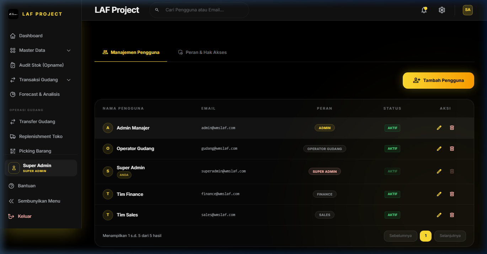

# BAB 8: MANAJEMEN AKSES & KEAMANAN SISTEM

## Manajemen Akses & Keamanan Pengguna (User & Role Access Control)

### 1. Deskripsi Singkat
Modul Manajemen Akses mengatur otentikasi akun pengguna (*User Management*), kredensial login, status aktif/non-aktif akun, serta alokasi peran (*Roles & Permissions*) menggunakan standar Spatie Permission RBAC (Role-Based Access Control) di WMS LAF Project.

---

### 2. Role / Hak Akses
- **Akses Sistem Administrator (`manage system`)**: Super Admin saja.

---

### 3. Lokasi Menu (Path / URL)
- **Path Navigasi**: Sidebar -> Manajemen Akses
- **URL**: `/user-management`

---

### 4. Alur Penggunaan (Step by Step)

#### **A. Menambah Pengguna Baru**
1. Buka menu **Manajemen Akses** -> Klik tombol **+ Tambah Pengguna Baru**.
2. Isi **Nama Lengkap**, **Alamat Email** (Unik), dan **Password** (min 8 karakter + konfirmasi).
3. Pilih **Peran / Role**:
   - `super_admin`: Memiliki seluruh akses termasuk manajemen sistem pengguna.
   - `admin`: Memiliki seluruh akses operasional gudang, master, dan laporan keuangan (kecuali user management).
   - `operator_gudang`: Akses khusus transaksi barang masuk, barang keluar, transfer, opname, picking, dan packing.
   - `sales`: Akses khusus pencatatan barang keluar, buat PO, dan pratinjau katalog stok.
   - `finance`: Akses khusus laporan analitik, nilai inventori, dan transaksi PO/Stok.
4. Tentukan **Status Akun** (Aktif / Non-Aktif).
5. Klik **Simpan Pengguna**.

#### **B. Mengedit Data / Reset Password Pengguna**
1. Klik tombol **Edit** pada baris pengguna yang ingin diubah.
2. Ubah data nama, email, role, atau centang ubah password jika pengguna lupa kata sandi.
3. Klik **Perbarui Pengguna**.

#### **C. Menonaktifkan Akun Pengguna**
1. Klik tombol **Nonaktifkan Akun** (atau ubah status `is_active` menjadi false).
2. Pengguna yang dinonaktifkan tidak akan bisa login ke dalam sistem WMS LAF Project meskipun password benar.

---

### 5. Penjelasan Field User Management

| Nama Field | Tipe Input | Wajib / Opsional | Keterangan & Validasi |
|---|---|---|---|
| `name` | Text | Wajib | Nama pengguna lengkap (maks 255 karakter) |
| `email` | Email | Wajib | Alamat email unik login pengguna (Unique in `users`) |
| `password` | Password | Wajib* | Kata sandi minimal 8 karakter (*Wajib saat buat baru, opsional saat edit) |
| `password_confirmation` | Password | Wajib* | Konfirmasi ulang kata sandi (Harus identik dengan `password`) |
| `roleName` | Select | Wajib | Pilihan Role Spatie (`super_admin`, `admin`, `operator_gudang`, `sales`, `finance`) |
| `is_active` | Toggle / Select | Wajib | Status akun pengguna (`Aktif` / `Non-Aktif`) |

---

### 6. Tombol & Aksi

| Nama Tombol | Aksi & Efek ke Sistem |
|---|---|
| **+ Tambah Pengguna Baru** | Membuka modal form pendaftaran akun user WMS baru. |
| **Edit Pengguna** | Membuka modal penyuntingan nama, role, email, dan reset password. |
| **Nonaktifkan / Aktifkan** | Mengubah status keaktifan `is_active` pengguna secara instan. |
| **Hapus User** | Memindahkan/menghapus akun user (Super Admin terlindungi dari penghapusan mandiri). |

---

### 7. Validasi & Aturan Bisnis (Controller `UserManagement\Index.php`)
- **Proteksi Super Admin Mandiri**: Pengguna `super_admin` **TIDAK BISA MENGHAPUS ATAU MENONAKTIFKAN AKUNNYA SENDIRI** saat sedang dalam posisi login untuk mencegah terkuncinya sistem (*System Lockout Protection*).
- **Enkripsi Kredensial**: Password disimpan di database menggunakan enkripsi hashing aman `Bcrypt` (`Hash::make()`).

---

### 8. Keamanan & Log Out Session
- **Pemberhentian Sesi**: Pengguna dapat keluar dari sistem dengan mengklik tombol **Keluar (Logout)** di bagian paling bawah sidebar utama. Sesi cookie dan token CSRF otomatis dihanguskan.
